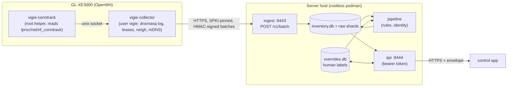

<!-- glowup:hero start -->
<div align="center">
<h1>
  <picture>
    <source media="(prefers-color-scheme: dark)" srcset="docs/assets/banner.svg">
    
  </picture>
</h1>

[](LICENSE)


</div>
<!-- glowup:hero end -->

# Vigie

License: AGPL-3.0 (see `LICENSE`).

Vigie characterises the devices on a home LAN. A small agent on the router (GL.iNet GL-XE3000,
OpenWrt 21.02) reports DHCP leases, DNS queries, neighbour tables and conntrack summaries over
HTTPS to a server you run. The server stitches them into a device inventory with provenance. A
separate control app reads that inventory through a token-protected API and records the owner's
labels. Nothing leaves the LAN.

The design is in [`docs/prp/001-vigie-architecture.md`](docs/prp/001-vigie-architecture.md). That
file is **rev 3**. Human identity actions and standing-rule permissions are described in
[`docs/api.md`](docs/api.md).



## Status

Honest state of this repository. "Reviewed" means built by one agent and attacked by a separate
reviewer (PRP section 17), not run in production.

| Component | Where | State |
|---|---|---|
| Ingest service (`vigie_ingest`) | `server/` | Built, 4 review rounds, tests pass |
| Pipeline core (`vigie_pipeline`) | `server/` | Bounded identity stitching, conservative service characterization, hourly coverage, pooled upload baselines and explainable incidents are merged; field accuracy remains unmeasured; no LLM/ML stage |
| App API (`vigie_api`) | `server/` | Inventory/identity writes plus authenticated coverage, activity and incident reads, and a redacted per-device evidence-pack export (`POST /devices/{id}/evidence-pack`). See `docs/api.md` and `docs/monitoring.md`; monitoring UI and notification lifecycle remain queued |
| Container image, compose, cert and provisioning scripts | `deploy/` | Three owned rootless server roles are healthy with verified mounts, TLS and API scopes; see [current field status](docs/monitoring-field-status-2026-10-25.md). Cold boot/restore and long soak remain pending |
| Router collector agent (`vigie-collector`) | `collector/agent/` | Running with actual privilege checks and signed parsed-DNS delivery; LAN correction yields source flags 0, with earlier degraded history retained. Controlled drain and portable stop/restart passed; processing-age API is deployed and verified. See [field status](docs/monitoring-field-status-2026-10-25.md); long soak has not started |
| Conntrack root helper (`vigie-conntrack`) | `collector/conntrack-helper/` | Live helper/socket path exercised; it remains a separate root service. Lifecycle, boot and long-soak acceptance remain separate gates |
| DHCP log, conntrack and `ubus` output formats | router | Leases, neighbors, conntrack, selected procd metadata and parsed DNS have been observed. DHCP option 55/60 capture and remaining firmware cases await field verification |
| Router-side scripts (dnsmasq drop-in, watchdog, procd init) | `collector/agent/deploy/` | Real logging, renewed privilege checks, portable UID scan and controlled stop/restart passed; 20 MiB logfs capacity proof passed before writers. Boot links and scoped cron installation passed; drop-in repair and read-only-reconciled helper respawn passed; natural rotation and cold boot remain pending |
| Endpoint connection events (`endpoint-ingest`) | [`docs/prp/003-endpoint-events.md`](docs/prp/003-endpoint-events.md) | Proposed (design only); nothing built |
| LLM / ML classification stages | none | **Not built** |
| Control app | separate project | Out of scope here |

The real collector, ingest, pipeline and API can be exercised together on localhost with
[`tests/e2e/run_e2e.sh`](tests/e2e/run_e2e.sh). The [2026-10-25 field status](docs/monitoring-field-status-2026-10-25.md)
separates merged source, live server/router evidence and remaining quality/recovery gates. The real
48-hour run has not started; no mature field baseline, cold-boot acceptance or classification accuracy is claimed.

## Server quick start

Requirements: rootless podman, `podman-compose` (1.x), `openssl`, a LAN address for the server.
All paths below are relative to the repository root. Nothing in `deploy/` contains a secret;
secrets are podman secrets created by the scripts.

```sh
cd deploy
cp .env.example .env && $EDITOR .env            # set VIGIE_LAN_ADDR (required)

# 1. Self-signed certificates (ECDSA P-256) and podman secrets: one for ingest (collectors pin it,
#    note the printed pin) and a SEPARATE one for the API, so ingest never holds the API's key.
VIGIE_CERT_SAN="DNS:vigie.lan,IP:192.0.2.10" ./gen-certs.sh --create-secrets
VIGIE_CERT_SAN="DNS:vigie.lan,IP:192.0.2.10" ./gen-certs.sh --role api --create-secrets

# 2. Build the image (one image, three services)
podman build -f Containerfile -t localhost/vigie-server:dev ..

# 3. Collector: key -> podman secret -> database row. Prints the router-side config.
./provision-collector.sh rtr-1 k1      # k1 is the key id compose.yaml lists by default

# 4. Start
podman-compose up -d
podman-compose ps                       # healthy after up to ~2-3 minutes: the pipeline has a 120 s
                                        # grace period and needs the collector from step 3 first
```

`provision-collector.sh` registers the collector only when `compose.yaml` already lists
`collector_key_<key_id>` under ingest's secrets (ingest refuses to start when a registered
collector has no key file). For a second collector or a new key id it prints the exact lines to add
and the order to follow.

Create an API token (printed once on stdout, its id on stderr; store it in your control app):

```sh
podman-compose run --rm --no-deps api python -m vigie_api tokens create --id control-app
```

Call the API (responses use the envelope `{ok, data, error, page}`):

```sh
TOKEN=vgt_...   # the token printed above
curl --cacert deploy/certs-api/server.crt -H "Authorization: Bearer $TOKEN" \
  "https://192.0.2.10:8444/devices?include_transient=1"
# {"ok":true,"data":[...],"error":null,"page":{"next_cursor":null}}

curl --cacert deploy/certs-api/server.crt https://192.0.2.10:8444/healthz       # unauthenticated
curl --cacert deploy/certs-api/server.crt -H "Authorization: Bearer $TOKEN" \
  "https://192.0.2.10:8444/events?since=0"
curl --cacert deploy/certs-api/server.crt -H "Authorization: Bearer $TOKEN" \
  https://192.0.2.10:8444/macs/02:00:00:dd:ee:ff            # 404 = unknown MAC = unassigned

# Writes need If-Match with the device's current ETag (428 if absent, 412 on mismatch):
curl --cacert deploy/certs-api/server.crt -H "Authorization: Bearer $TOKEN" \
  -H 'If-Match: "0"' -H 'Content-Type: application/json' -X PATCH \
  -d '{"name":"Kitchen speaker","group_id":"kids"}' https://192.0.2.10:8444/devices/<device-id>
```

(`--cacert` works because the certificate's SAN contains the address you connect to. The ETag
format is `"<override version>"`; read it from a prior `GET /devices/<id>`.) The contract is
`api/openapi.yaml`; the collector wire format is `api/batch.schema.json`.

Design notes that affect operation:

- **Ingest must be a single worker.** It holds an exclusive `flock` on `<raw dir>/.ingest.lock`
  and refuses `--workers` above 1. **The volumes must be on a local filesystem** (no NFS/SMB:
  `flock` and SQLite WAL both need it).
- **Three volumes, PRP section 5 ownership.** `vigie-raw` (ingest rw, pipeline ro), `vigie-inv`
  (ingest and pipeline rw, api ro), `vigie-overrides` (api rw, pipeline ro, ingest not mounted). The
  read-only mounts work because each writer keeps one SQLite connection open (a "keeper"); readers
  fail closed when it is gone. A read-only open of the WAL `overrides.db` still creates
  `overrides.db-wal`/`-shm` next to it (the file bytes are never changed), so that directory must be
  writable by the pipeline's uid or kept alive by the writer's connection. The exact table and the writable paths per service are in
  `docs/deploy.md`; none of this has run in a real container yet.
- Ports are published on `VIGIE_LAN_ADDR` only; compose refuses to start when it is unset.
- **Restrict who can reach the ingest (8443) and API (8444) ports on the server host.** Traffic
  between two hosts on the router's LAN bridge never passes the router's firewall, and Fedora-family
  default zones (for example `FedoraWorkstation`) may already open ports 1025-65535, so merely
  "not opening" a port is not enough: add an explicit reject for every other source. Assumptions
  (flagged): rootless podman, so the published ports terminate in a host process that firewalld's
  input rules see; the router is `192.168.8.1`; the control app host is `192.0.2.50`; the zone is
  the default zone. Rich rules are evaluated reject/drop first, then accept, so use the
  `source not address` form (a reject that never matches the allowed source) rather than a blanket
  reject:
  ```sh
  sudo firewall-cmd --permanent --add-rich-rule='rule family="ipv4" source address="192.168.8.1" port port="8443" protocol="tcp" accept'
  sudo firewall-cmd --permanent --add-rich-rule='rule family="ipv4" source not address="192.168.8.1" port port="8443" protocol="tcp" reject'
  sudo firewall-cmd --permanent --add-rich-rule='rule family="ipv4" source address="192.0.2.50" port port="8444" protocol="tcp" accept'
  sudo firewall-cmd --permanent --add-rich-rule='rule family="ipv4" source not address="192.0.2.50" port port="8444" protocol="tcp" reject'
  sudo firewall-cmd --reload
  sudo firewall-cmd --list-rich-rules
  ```
  Verify from a SECOND host that is not allowed (`nc -vz 192.0.2.10 8443` must be refused, and the
  same for 8444) and from the router or control app that it still connects. Undo: run the same four
  commands with `--remove-rich-rule` instead of `--add-rich-rule`, then `--reload`.
  Rootless networking may rewrite the peer address the ingest rate limiter sees; check
  `podman info --format '{{.Host.RootlessNetworkCmd}}'` (pasta should preserve it, slirp4netns may not).

Local development without containers: `cd server && uv sync && uv run pytest`
(see [`server/README.md`](server/README.md)).

## Local and hosted checks

Run `scripts/ci.sh` from any directory to run the complete gate: Python tests with coverage,
ruff lint/format checks, Rust workspace tests, deployment checks, protocol contracts and the real whole-chain
localhost test. It stops on the first failed stage and prints the retained log path.
`scripts/ci.sh --list` lists stages; names select a subset, for example `scripts/ci.sh server contracts`.
Only the default full invocation represents the full gate.

Requirements: Python 3.12, uv, a host Rust toolchain with a C compiler, OpenSSL, Bash and standard
Linux utilities. uv installs locked development dependencies; the deploy checker additionally uses
PyYAML 6.0.3 as test tooling. Override `VIGIE_CI_SERVER_ENV`, `VIGIE_CI_TRAFFICGEN_ENV`,
`CARGO_TARGET_DIR`, `UV_CACHE_DIR`, `TMPDIR` and `VIGIE_CI_LOG_DIR` for local environments/caches.
For an already provisioned offline environment, `UV_NO_SYNC=1` skips dependency installation;
that run does not verify that installed versions match the locks. Whole-chain scratch storage uses
the `VIGIE_E2E_*` variables documented in `docs/e2e.md`.
The gate builds host binaries and makes no router, firewall or container deployment changes.
`.github/workflows/ci.yml` runs the same gate on pushes, pull requests and manual dispatch;
a hosted result exists only after the workflow actually runs.

## Router install (GL-XE3000, OpenWrt 21.02, aarch64)

**Owner gate: these are reference installation steps, pending the couvre-feu integration
decisions D1–D6.** The scoped field rollout has explicit owner authorization; it does not settle
general couvre-feu integration. Other installations need their own authorization to change
dnsmasq before starting the collector service or running a logging/drop-in script.
The current service changes dnsmasq configuration; a lease-only coexistence mode is still planned.
Everything here is run by you, as root, by hand;
nothing is executed for you. Every command below that reads like a fact about the router is an
assumption until you have seen its output.

Assumptions: router LAN address `192.168.8.1` (GL.iNet default; PRP examples use other values, use
yours), SSH as root works, and the files come from this checkout.
Explicitly set the collector's three [LAN scope keys](docs/deploy.md#collector-lan-scope) from
the measured network; parser defaults are not a deployment configuration.

1. **Build** on your workstation from this repository root (Rust, clang and the musl target
   are required; cross-compilation settings are in `collector/.cargo/config.toml`):
   ```sh
   rustup target add aarch64-unknown-linux-musl
   (cd collector && cargo build --locked --release --target aarch64-unknown-linux-musl -p vigie-collector -p vigie-conntrack -p vigie-privdrop)
   ```
   Both binaries land in collector/target/aarch64-unknown-linux-musl/release/, unless
   `CARGO_TARGET_DIR` overrides the location. `vigie-collector`, `vigie-conntrack` and the root-invoked [privilege transition helper](docs/privdrop.md) run
   on the router; `net-spike` is a test tool. Deploy scripts live in `collector/agent/deploy/`.
2. **Create the `vigie` user.** Run the printer locally; it executes nothing:
   `sh collector/agent/deploy/vigie-print-install-commands.sh`. Review the output and run it on the
   router. It picks a free uid in 6700-6799. **Use that uid** for the conntrack helper
   (`--uid N --gid N`); the conntrack spike's `10001` is only an example.
   Validate: `id vigie` shows the printed uid; `ps | grep vigie-collector` later shows it is
   not root or nobody.
3. **Copy the files** (`scp -O`, the legacy protocol, because OpenWrt has no sftp-server):
   ```sh
   ssh root@192.168.8.1 mkdir -p /tmp/vigie-deploy
   scp -O collector/target/aarch64-unknown-linux-musl/release/vigie-collector \
          collector/target/aarch64-unknown-linux-musl/release/vigie-conntrack \
          collector/target/aarch64-unknown-linux-musl/release/vigie-privdrop \
          root@192.168.8.1:/tmp/
   scp -O collector/agent/deploy/* root@192.168.8.1:/tmp/vigie-deploy/
   ```
   Then on the router install them root-owned, as listed in the printer's step 2:
   `/usr/bin/vigie-collector`, `/usr/bin/vigie-conntrack`, `/usr/bin/vigie-privdrop` (root:root 0755, never SUID/SGID), the scripts in `/usr/libexec/vigie/`,
   `/etc/init.d/vigie-collector` (755) and `/etc/vigie/collector.conf`.
4. **Key and config.** `deploy/provision-collector.sh` printed the exact `scp -O` line for the key
   (to `/etc/vigie/key`, then `chown vigie:vigie` and `chmod 0600`) and the `collector.conf`
   content. `pin1`/`pin2` are 64 lowercase hex characters, must differ, and are the SPKI SHA-256
   printed by `gen-certs.sh` (the hex form; the server README's base64 form is for other tools).
   Delete the key file from your workstation after verifying: `shred -u` is best-effort on
   SSDs.
5. **Start the collector service** (this also runs the root drop-in script):
   ```sh
   /etc/init.d/vigie-collector enable && /etc/init.d/vigie-collector start
   echo '*/5 * * * * /usr/libexec/vigie/vigie-dnsmasq-dropin.sh ensure; /usr/libexec/vigie/vigie-log-watchdog.sh' >> /etc/crontabs/root
   /etc/init.d/cron restart
   ```
   Validate (these are the assumptions to check, section "Security notes" below):
   `ls -ln /tmp/vigie /tmp/vigie/dnsmasq.log`, then
   `/etc/init.d/dnsmasq restart; sleep 2; logread | grep dnsmasq | tail` (no "cannot open log"),
   and `tail -n1 /tmp/vigie/dnsmasq.log` shows new lines.
6. **Conntrack helper.** Install the checked-in `collector/agent/deploy/vigie-conntrack.init`
   as `/etc/init.d/vigie-conntrack` with mode 755, following the install printer's exact commands.
   The service resolves the dedicated `vigie` user's uid/gid and starts the helper on
   `/tmp/vigie/conntrack.sock`. Start the collector/drop-in service first so the shared
   `/tmp/vigie` directory has root ownership and the vigie group with mode 0751; then enable
   and start the helper. Verify `ls -ld /tmp/vigie` and service processes before collecting.
   Actual OpenWrt procd behavior, privileges and reboot recovery still require owner validation.
   First capture a masked `/proc/net/nf_conntrack` sample and follow
   `docs/spikes/conntrack-helper.md` to check the real parser's `skipped_lines`.
7. **Force DNS through dnsmasq and block DoT bypass** (PRP section 9). Without this, devices
   using DoH/DoT are invisible to the DNS log. OpenWrt 21.02 uses fw3 over iptables. Use UCI
   `redirect`/`rule` sections (named, so they can be deleted exactly; GL.iNet's firewall UI may still
   rewrite them, unverified on firmware 4.8.3). On the router, as root:
   ```sh
   LAN_IP=$(uci get network.lan.ipaddr)        # do not hard-code it
   for proto in udp tcp; do
     uci set firewall.vigie_dns_$proto=redirect
     uci set firewall.vigie_dns_$proto.name="vigie-dns-$proto"
     uci set firewall.vigie_dns_$proto.src=lan
     uci set firewall.vigie_dns_$proto.src_dport=53
     uci set firewall.vigie_dns_$proto.src_dip="!$LAN_IP"   # only queries aimed elsewhere
     uci set firewall.vigie_dns_$proto.proto=$proto
     uci set firewall.vigie_dns_$proto.dest_ip="$LAN_IP"
     uci set firewall.vigie_dns_$proto.dest_port=53
     uci set firewall.vigie_dns_$proto.target=DNAT
   done
   uci set firewall.vigie_dot=rule              # DNS-over-TLS has no redirect: reject it
   uci set firewall.vigie_dot.name=vigie-block-dot
   uci set firewall.vigie_dot.src=lan
   uci set firewall.vigie_dot.dest=wan
   uci set firewall.vigie_dot.proto=tcp
   uci set firewall.vigie_dot.dest_port=853
   uci set firewall.vigie_dot.target=REJECT
   uci commit firewall && /etc/init.d/firewall reload
   ```
   **Rollback of this step** (exact): `uci delete firewall.vigie_dns_udp; uci delete
   firewall.vigie_dns_tcp; uci delete firewall.vigie_dot; uci commit firewall;
   /etc/init.d/firewall reload`. If you prefer raw iptables in `/etc/firewall.user` instead, the
   equivalents are `iptables -t nat -I PREROUTING -i br-lan -p udp --dport 53 ! -d $LAN_IP -j DNAT
   --to-destination $LAN_IP:53` (and `-p tcp`) plus `iptables -I FORWARD -i br-lan -p tcp --dport 853
   -j REJECT`; undo each with the same line using `-D` instead of `-I`, then `/etc/init.d/firewall
   restart`.
   **Known gaps**: this is IPv4 only (fw3 on 21.02 has no IPv6 DNAT), so a client that resolves over
   IPv6 to an external resolver is not redirected: add `config rule` REJECT entries with `option
   family 'ipv6'` for destination ports 53 and 853 to force it back to IPv4/dnsmasq (unverified).
   Only the `lan` zone is covered; a guest network or other bridge needs its own `redirect` with
   its own `src` zone. DoH on port 443 cannot be caught by address: the earlier idea of rejecting
   `1.1.1.1:443` and `8.8.8.8:443` is not used here because it also breaks ordinary HTTPS to those
   hosts (both serve websites). Blocking known DoH hostnames needs a maintained list and is yours.
   Validate: from a LAN host `dig @9.9.9.9 example.com` still answers (it was redirected) and the
   query appears in `/tmp/vigie/dnsmasq.log`; `uci show firewall | grep vigie`. Also check the WAN
   side: from outside, port 53 on the WAN address must be dropped (PRP section 9; probably already
   so, never tested from outside).
8. **Firewall for the collector's own traffic.** The collector opens no listener, so the router needs
   no inbound rule for Vigie. The rule that limits who can reach the ingest port is on the server
   host (see above).

**Rollback requires the exact installation journal and drift checks.** Follow the ordered
[router filesystem rollback boundary](docs/router-logfs.md#reviewable-rollout-and-rollback-boundary):
stop owned ensure jobs and collectors first, restore and verify DNS, then review a normal unmount.
Preserve keys/configuration, logs, legacy directories and unrelated accounts/rules. Do not recursively
remove the mounted log tree or blanket-delete shared account, cron or firewall entries.

Server rollback likewise stops only owned units and restores exact journaled files while retaining
volumes, secrets and evidence; see the [persistent deployment plan](deploy/persistent/README.md).

A reboot discards tmpfs data (logs and helper socket). The reviewed early init must recreate the
bounded log filesystem and drop-in before DNS starts; verify this on the actual firmware before
unattended operation. Flash files remain. A firmware upgrade removes `/etc/vigie` including the key (not in the default
sysupgrade keep list); re-provision with `provision-collector.sh --force`.

## Security notes: verify these on the router

The [bounded field pilot](docs/router-validation-2026-10-24.md) exercised temporary real-router collection. Permanent init, privilege-drop artifact, DNS ownership/recovery and reboot checks below still need their separate reviewed acceptance evidence.

- **Log ownership**: `ls -ln /tmp/vigie /tmp/vigie/dnsmasq.log`. Expected: directory
  `drwxr-x--x` (0751), uid 0, group = the vigie gid; log `-rw-r-----`, group = the vigie gid. If
  dnsmasq created the file with its own group, the collector cannot read it and the layout must
  change. The log holds every client's DNS history; it must not be world-readable.
- **DHCP log sample**: `grep -m3 -i 'DHCPREQUEST\|requested options\|vendor class' /tmp/vigie/dnsmasq.log`
  (mask MACs before sharing). The collector assumes option 55 and 60 appear on `log-dhcp` lines.
- **Conntrack sample**: `head -5 /proc/net/nf_conntrack` and `grep -m2 ipv6 /proc/net/nf_conntrack`
  (mask IPs); then the helper's `--once` run and its `skipped_lines`.
- **Root-lane test**: the root scripts refuse unsafe paths and report with exit 70. Test command
  (on a development host with this checkout, as an unprivileged user):
  `cd collector/agent && cargo test --test review_deploy_scripts --test review_deploy_v2 --test review4_deploy`.
  On the router, run `/usr/libexec/vigie/vigie-dnsmasq-dropin.sh check` (exit 0 ok, 1 missing,
  2 differs or unsafe) and `/usr/libexec/vigie/vigie-log-watchdog.sh`, then `logread -e vigie`.
- **Processes**: `ps | grep -E 'vigie-collector|dnsmasq'` must show the collector as the dedicated
  user, never root or nobody (avahi shares nobody's uid and could read the HMAC key).
- **Key and config**: `ls -l /etc/vigie` shows `key` as `vigie:vigie` 0600 and `collector.conf`
  0644. Adding `/etc/vigie` to `/etc/sysupgrade.conf` puts the key into config backups.
- **Server certificate pinning is the only trust anchor** between router and server. A server
  certificate rotation needs the next pin on the router first (`docs/deploy.md`).

## Where to read more

- Product roadmap: [`docs/roadmap.md`](docs/roadmap.md), with the
  [feature research](docs/research/network-monitoring-features-2026-10-24.md).
- Operations (backups, retention, upgrades, key and pin rotation, permission model):
  [`docs/deploy.md`](docs/deploy.md)
- Architecture: [`docs/prp/001-vigie-architecture.md`](docs/prp/001-vigie-architecture.md) (rev 3)
- Spikes: [`docs/spikes/p0-router.md`](docs/spikes/p0-router.md) (router facts);
  `docs/spikes/p2-collector-agent.md`;
  `docs/spikes/conntrack-helper.md`;
  `docs/spikes/p1-collector-net.md`
- Server details and wire contract: [`server/README.md`](server/README.md)
