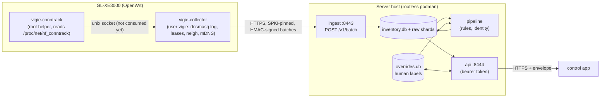

# Vigie

License: AGPL-3.0 (see `LICENSE`).

Vigie characterises the devices on a home LAN. A small agent on the router (GL.iNet GL-XE3000,
OpenWrt 21.02) reports DHCP leases, DNS queries, neighbour tables and conntrack summaries over
HTTPS to a server you run. The server stitches them into a device inventory with provenance. A
separate control app reads that inventory through a token-protected API and records the owner's
labels. Nothing leaves the LAN.

The design is in [`docs/prp/001-vigie-architecture.md`](docs/prp/001-vigie-architecture.md). That
file is **rev 2**; the current design (sections 4, 6, 9, 17) is **rev 3** on branch `docs/prp-rev3`.



## Status

Honest state of this repository. "Reviewed" means built by one agent and attacked by a separate
reviewer (PRP section 17), not run in production.

| Component | Where | State |
|---|---|---|
| Ingest service (`vigie_ingest`) | `server/` | Built, 4 review rounds, tests pass |
| Pipeline core (`vigie_pipeline`) | `server/` | Built, reviewed. **No LLM or ML stage**, rules only |
| App API (`vigie_api`) | `server/` | Built, 2 review rounds. Not yet: accept/reject/merge/undo, identity rules, SSE, metrics |
| Container image, compose, cert and provisioning scripts | `deploy/` | Written; scripts tested with a stub podman. **The image has never been built and the stack never started** (no container runtime in the authoring sandbox) |
| Router collector agent (`vigie-collector`) | branch `feat/collector` | Built, reviewed, host-tested. **No HTTPS client and no SPKI pinning: it ships a `NoTransport` that refuses to send, so the collector cannot push to the server yet** |
| Conntrack root helper (`vigie-conntrack`) | branch `feat/conntrack-helper` | Built, reviewed, host-tested. **The collector does not read its socket yet** |
| DHCP log, conntrack and `ubus` output formats | router | **Unverified on the router.** Parsers are written against assumed formats and fixtures (PRP section 17, spikes) |
| Router-side scripts (dnsmasq drop-in, watchdog, procd init) | branch `feat/collector` | Never run on the router; procd retry semantics and dnsmasq log ownership are assumptions |
| LLM / ML classification stages | none | **Not built** |
| Control app | separate project | Out of scope here |

Consequence: the server side can be brought up and exercised with `curl` today, but no real data
will arrive from the router until the collector gets its HTTPS client.

## Server quick start

Requirements: rootless podman, `podman-compose` (1.x), `openssl`, a LAN address for the server.
All paths below are relative to the repository root. Nothing in `deploy/` contains a secret;
secrets are podman secrets created by the scripts.

```sh
cd deploy
cp .env.example .env && $EDITOR .env            # set VIGIE_LAN_ADDR (required)

# 1. Self-signed certificate (ECDSA P-256) and podman secrets. Note the printed pin.
VIGIE_CERT_SAN="DNS:vigie.lan,IP:192.168.1.10" ./gen-certs.sh --create-secrets

# 2. Build the image (one image, three services)
podman build -f Containerfile -t localhost/vigie-server:dev ..

# 3. Collector: key -> podman secret -> database row. Prints the router-side config.
./provision-collector.sh rtr-1 k1      # k1 is the key id compose.yaml lists by default

# 4. Start
podman-compose up -d
podman-compose ps                       # all three "healthy" after ~30 s
```

`provision-collector.sh` registers the collector only when `compose.yaml` already lists
`collector_key_<key_id>` under ingest's secrets (ingest refuses to start when a registered
collector has no key file). For a second collector or a new key id it prints the exact lines to add
and the order to follow.

Create an API token (printed once on stdout, its id on stderr; store it in your control app):

```sh
podman-compose run --rm --no-deps api python -m vigie_api tokens create --id control-app
```

Call the API (responses use the envelope `{ok, data, error, page}`):

```sh
TOKEN=vgt_...   # the token printed above
curl --cacert deploy/certs/server.crt -H "Authorization: Bearer $TOKEN" \
  "https://192.168.1.10:8444/devices?include_transient=1"
# {"ok":true,"data":[...],"error":null,"page":{"next_cursor":null}}

curl --cacert deploy/certs/server.crt https://192.168.1.10:8444/healthz       # unauthenticated
curl --cacert deploy/certs/server.crt -H "Authorization: Bearer $TOKEN" \
  "https://192.168.1.10:8444/events?since=0"
curl --cacert deploy/certs/server.crt -H "Authorization: Bearer $TOKEN" \
  https://192.168.1.10:8444/macs/aa:bb:cc:dd:ee:ff            # 404 = unknown MAC = unassigned

# Writes need If-Match with the device's current ETag (428 if absent, 412 on mismatch):
curl --cacert deploy/certs/server.crt -H "Authorization: Bearer $TOKEN" \
  -H 'If-Match: "0"' -H 'Content-Type: application/json' -X PATCH \
  -d '{"name":"Kitchen speaker","group_id":"kids"}' https://192.168.1.10:8444/devices/<device-id>
```

(`--cacert` works because the certificate's SAN contains the address you connect to. The ETag
format is `"<override version>"`; read it from a prior `GET /devices/<id>`.) The contract is
`api/openapi.yaml`; the collector wire format is `api/batch.schema.json`.

Design notes that affect operation:

- **Ingest must be a single worker.** It holds an exclusive `flock` on `<data dir>/.ingest.lock`
  and refuses `--workers` above 1. **The data volume must be on a local filesystem** (no NFS/SMB:
  `flock` and SQLite WAL both need it).
- **Read-only boundaries are enforced in code, not by mount flags.** Both `inventory.db` and
  `overrides.db` are SQLite WAL files; a reader on a read-only mount fails with "attempt to write
  a readonly database" whenever no writer has the file open. So api and pipeline mount their
  volumes read-write and open the databases `mode=ro` + `query_only` in code. Ingest never mounts the
  overrides volume (that isolation is structural). Details in `deploy/compose.yaml` and
  `docs/deploy.md`.
- Ports are published on `VIGIE_LAN_ADDR` only; compose refuses to start when it is unset.
- Restrict the ingest port to the router on the **server host's** firewall (traffic between two
  LAN hosts does not pass through the router's firewall). Firewalld example (assumes the router's
  LAN address is 192.168.8.1; flagged assumption):
  `sudo firewall-cmd --permanent --add-rich-rule='rule family=ipv4 source address=192.168.8.1 port port=8443 protocol=tcp accept'`
  with that port not otherwise opened in the zone. Rootless networking may rewrite the peer
  address the ingest rate limiter sees; check `podman info --format '{{.Host.RootlessNetworkCmd}}'`
  (pasta should preserve it, slirp4netns may not).

Local development without containers: `cd server && uv sync && uv run pytest`
(see [`server/README.md`](server/README.md)).

## Router install (GL-XE3000, OpenWrt 21.02, aarch64)

**Read the Status table first: until the HTTPS client exists, these steps install a collector that
parses and spools but never sends.** They are still useful to verify the router-side assumptions
(log ownership, DHCP and conntrack formats). Everything here is run by you, as root, by hand;
nothing is executed for you. Every command below that reads like a fact about the router is an
assumption until you have seen its output.

Assumptions: router LAN address `192.168.8.1` (GL.iNet default; PRP examples use other values, use
yours), SSH as root works, and the files come from the branches named below.

1. **Build** on your workstation (needs a Rust toolchain and the musl target; rustls additionally
   needs a C cross compiler, see the p2 spike):
   ```sh
   git checkout feat/collector && cd collector
   cargo build --release --target aarch64-unknown-linux-musl -p vigie-collector
   git checkout feat/conntrack-helper && cd collector
   cargo build --release --target aarch64-unknown-linux-musl -p vigie-conntrack
   ```
   Only **two** binaries run on the router: `vigie-collector` and `vigie-conntrack`. (`net-spike`
   is a test tool, not a deployable.) The deploy scripts live in `collector/agent/deploy/` on
   `feat/collector`.
2. **Create the `vigie` user.** Run the printer locally; it executes nothing:
   `sh collector/agent/deploy/vigie-print-install-commands.sh`. Review the output and run it on the
   router. It picks a free uid in 6700-6799. **Use that uid** for the conntrack helper
   (`--uid N --gid N`); the conntrack spike's `10001` is only an example.
   Validate: `id vigie` shows the printed uid; `ps | grep vigie-collector` later shows it is
   not root or nobody.
3. **Copy the files** (`scp -O`, the legacy protocol, because OpenWrt has no sftp-server):
   ```sh
   scp -O target/aarch64-unknown-linux-musl/release/vigie-collector \
          target/aarch64-unknown-linux-musl/release/vigie-conntrack root@192.168.8.1:/tmp/
   scp -O collector/agent/deploy/* root@192.168.8.1:/tmp/vigie-deploy/   # mkdir it first
   ```
   Then on the router install them root-owned, as listed in the printer's step 2:
   `/usr/bin/vigie-collector`, `/usr/bin/vigie-conntrack`, the scripts in `/usr/libexec/vigie/`,
   `/etc/init.d/vigie-collector` (755) and `/etc/vigie/collector.conf`.
4. **Key and config.** `deploy/provision-collector.sh` printed the exact `scp -O` line for the key
   (to `/etc/vigie/key`, then `chown vigie:vigie` and `chmod 0600`) and the `collector.conf`
   content. `pin1`/`pin2` are 64 lowercase hex characters, must differ, and are the SPKI SHA-256
   printed by `gen-certs.sh` (the hex form; the server README's base64 form is for other tools).
   Delete the key file from your workstation after verifying: `shred -u` is best-effort on
   SSDs.
5. **Start the collector service** (this also runs the root drop-in script):
   ```sh
   /etc/init.d/vigie-collector enable && /etc/init.d/vigie-collector start
   echo '*/5 * * * * /usr/libexec/vigie/vigie-dnsmasq-dropin.sh ensure; /usr/libexec/vigie/vigie-log-watchdog.sh' >> /etc/crontabs/root
   /etc/init.d/cron restart
   ```
   Validate (these are the assumptions to check, section "Security notes" below):
   `ls -ln /tmp/vigie /tmp/vigie/dnsmasq.log`, then
   `/etc/init.d/dnsmasq restart; sleep 2; logread | grep dnsmasq | tail` (no "cannot open log"),
   and `tail -n1 /tmp/vigie/dnsmasq.log` shows new lines.
6. **Conntrack helper** (separate procd service; the spike gives only a sketch,
   `docs/spikes/conntrack-helper.md` on `feat/conntrack-helper`). Write
   `/etc/init.d/vigie-conntrack` from that sketch with `--socket /tmp/vigie/conntrack.sock --uid N
   --gid N --interval 60`, `enable`, `start`. Validate with the spike's router steps first: capture
   `head -5 /proc/net/nf_conntrack` and run `/tmp/vigie-conntrack --once --file
   /proc/net/nf_conntrack` and check `skipped_lines` is near zero. The helper and the drop-in script
   both want `/tmp/vigie` (drop-in script: `root:vigie 0751`; helper: creates `0755` root if absent and
   refuses a wrong one). **Whether they accept each other's directory is unverified**; start the
   collector service first and run `ls -ld /tmp/vigie` after the helper starts.
7. **Force DNS through dnsmasq and block DoH/DoT bypass** (PRP section 9). Without this, devices
   using DoH/DoT are invisible to the DNS log. Example iptables (OpenWrt 21.02 has iptables, no
   `nft`), put the lines in `/etc/firewall.user` so fw3 reapplies them (GL.iNet's firewall UI may
   rewrite rules; unverified on firmware 4.8.3):
   ```sh
   LAN_IP=192.168.8.1
   iptables -t nat -I PREROUTING -i br-lan -p udp --dport 53 ! -d $LAN_IP -j DNAT --to-destination $LAN_IP:53
   iptables -t nat -I PREROUTING -i br-lan -p tcp --dport 53 ! -d $LAN_IP -j DNAT --to-destination $LAN_IP:53
   iptables -I FORWARD -i br-lan -p tcp --dport 853 -j REJECT          # DoT
   # Known DoH resolvers (examples; the list is yours to maintain, generic CDN DoH is not catchable):
   iptables -I FORWARD -i br-lan -p tcp -d 1.1.1.1 --dport 443 -j REJECT
   iptables -I FORWARD -i br-lan -p tcp -d 8.8.8.8 --dport 443 -j REJECT
   ```
   Validate: from a LAN host `dig @9.9.9.9 example.com` still answers (it was redirected) and the
   query appears in `/tmp/vigie/dnsmasq.log`; `iptables -t nat -S PREROUTING | grep 'dport 53'`.
   Also check the WAN side: from outside, port 53 on the WAN address must be dropped (PRP section 9;
   probably already so, never tested from outside).
8. **Firewall for the collector's own traffic.** The collector opens no listener, so the router needs
   no inbound rule for Vigie. The rule that limits who can reach the ingest port is on the server
   host (see above).

**Roll back everything** (as root on the router):

```sh
/etc/init.d/vigie-collector stop; /etc/init.d/vigie-collector disable
/etc/init.d/vigie-conntrack stop;  /etc/init.d/vigie-conntrack disable
rm -f /etc/init.d/vigie-collector /etc/init.d/vigie-conntrack /usr/bin/vigie-collector /usr/bin/vigie-conntrack
rm -rf /usr/libexec/vigie /etc/vigie /var/run/vigie-collector /tmp/vigie /tmp/vigie-deploy
rm -f /tmp/dnsmasq.d/vigie.conf && /etc/init.d/dnsmasq restart
sed -i '/vigie-dnsmasq-dropin.sh/d' /etc/crontabs/root && /etc/init.d/cron restart
sed -i '/^vigie:/d' /etc/passwd /etc/group /etc/shadow
# remove the iptables lines from /etc/firewall.user, then:
/etc/init.d/firewall restart
```

A reboot reverts everything under `/tmp` (the drop-in, logs, helper socket) but not the flash
files above. A firmware upgrade removes `/etc/vigie` including the key (not in the default
sysupgrade keep list); re-provision with `provision-collector.sh --force`.

## Security notes: verify these on the router

None of this has been observed on a real GL-XE3000 yet.

- **Log ownership**: `ls -ln /tmp/vigie /tmp/vigie/dnsmasq.log`. Expected: directory
  `drwxr-x--x` (0751), uid 0, group = the vigie gid; log `-rw-r-----`, group = the vigie gid. If
  dnsmasq created the file with its own group, the collector cannot read it and the layout must
  change. The log holds every client's DNS history; it must not be world-readable.
- **DHCP log sample**: `grep -m3 -i 'DHCPREQUEST\|requested options\|vendor class' /tmp/vigie/dnsmasq.log`
  (mask MACs before sharing). The collector assumes option 55 and 60 appear on `log-dhcp` lines.
- **Conntrack sample**: `head -5 /proc/net/nf_conntrack` and `grep -m2 ipv6 /proc/net/nf_conntrack`
  (mask IPs); then the helper's `--once` run and its `skipped_lines`.
- **Root-lane test**: the root scripts refuse unsafe paths and report with exit 70. Test command
  (on a development host with a checkout of `feat/collector`, as an unprivileged user):
  `cd collector/agent && cargo test --test review_deploy_scripts --test review_deploy_v2 --test review4_deploy`.
  On the router, run `/usr/libexec/vigie/vigie-dnsmasq-dropin.sh check` (exit 0 ok, 1 missing,
  2 differs or unsafe) and `/usr/libexec/vigie/vigie-log-watchdog.sh`, then `logread -e vigie`.
- **Processes**: `ps | grep -E 'vigie-collector|dnsmasq'` must show the collector as the dedicated
  user, never root or nobody (avahi shares nobody's uid and could read the HMAC key).
- **Key and config**: `ls -l /etc/vigie` shows `key` as `vigie:vigie` 0600 and `collector.conf`
  0644. Adding `/etc/vigie` to `/etc/sysupgrade.conf` puts the key into config backups.
- **Server certificate pinning is the only trust anchor** between router and server. A server
  certificate rotation needs the next pin on the router first (`docs/deploy.md`).

## Where to read more

- Operations (backups, retention, upgrades, key and pin rotation, permission model):
  [`docs/deploy.md`](docs/deploy.md)
- Architecture: [`docs/prp/001-vigie-architecture.md`](docs/prp/001-vigie-architecture.md) (rev 2
  here; rev 3 on branch `docs/prp-rev3`)
- Spikes: [`docs/spikes/p0-router.md`](docs/spikes/p0-router.md) (router facts, this branch);
  `docs/spikes/p2-collector-agent.md` (branch `feat/collector`);
  `docs/spikes/conntrack-helper.md` (branch `feat/conntrack-helper`);
  `docs/spikes/p1-collector-net.md` (branch `spike/p1-collector-net`)
- Server details and wire contract: [`server/README.md`](server/README.md)
