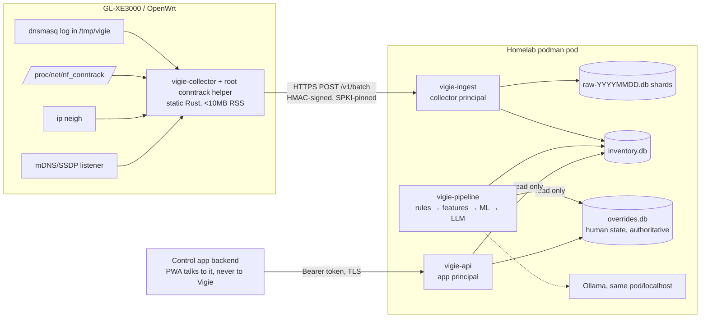

# PRP-001: Vigie — LAN device characterization service

Status: **REVISION 2 — revised after adversarial review (§15). Awaiting owner review. No implementation until approved.**
License: AGPL-3.0-or-later. Branch: `docs/prp-initial`.

## 1. Goal and non-goals

**Goal.** Infer what each LAN device is (phone, tv, iot, camera, laptop, console) from observed behavior, flag anomalies, and expose a device inventory API that a separate access-control app consumes. The control app keys everything on Vigie's **`device_id`**, never on MAC.

**Non-goals.**
- Vigie never changes firewall rules, DNS, DHCP, or any router state. It emits *suggestions*; the control app enforces after human approval.
- No payload inspection, no TLS interception, no cloud processing by default.
- Not an IDS. Anomaly flags are hints for a human.
- **A MAC address is not authentication.** Vigie can detect some MAC cloning (§8) but cannot prevent it. Group trust attaches to a `device_id` that a human confirmed; the control app must treat `identity_state != ok` as unassigned.
- **MACs are tracked, not trusted.** Many devices roll their MAC per SSID or even per connection, so a `device_id` owns a *set* of MACs over time (each with history and a link source). Vigie exists largely to re-attach rolled MACs to the right `device_id`. The control app enforces by `device_id` but needs the device's *current* MACs to program the router, so Vigie exposes them and emits a change event (§6).

**Success is measured**: per-phase accuracy against owner-labeled ground truth on the real LAN plus recorded fixtures (§11 exit criteria).

## 2. Environment (verified on the owner's router, 2026-10-20)

| Fact | Value | Consequence |
|---|---|---|
| Model / firmware | GL-XE3000, GL.iNet 4.8.3, OpenWrt 21.02 base, kernel 5.4.211 | older base; confirm behavior in P0 |
| SoC / arch | MediaTek MT7981, `aarch64_cortex-a53` | target `aarch64-unknown-linux-musl` |
| Memory | ~480 MB total, ~230 MB available; `/tmp` is a 240 MB tmpfs (shares RAM) | 10 MB RSS budget is comfortable; tmpfs files count against RAM |
| Resolver | plain **dnsmasq**; no AdGuard Home; query/DHCP logging **not enabled** | collector needs `log-queries=extra`, `log-dhcp`, `log-facility` in `/tmp/vigie/` |
| conntrack | `nf_conntrack_acct=1`; ~574 entries; `/proc/net/nf_conntrack` is `root:root 0440` | byte counters available; **needs a root helper** (see §4 privilege separation) |
| mDNS | `avahi-daemon` owns :5353; port 1900 free | multicast join needs `SO_REUSEPORT`; verify coexistence |
| Tools | `iptables`, `logread` present; **no `nft`, no `tcpdump`** | firewall docs use iptables/UCI; no packet capture |
| LAN layout | one bridge `br-lan` (wired `eth1` + both home Wi-Fi bands, `isolate=0`); guest Wi-Fi on separate `guest` network with `isolate=1` | see visibility limits |

### What the router cannot see
- Traffic between two clients on the same bridge (Wi-Fi↔Wi-Fi, Wi-Fi↔wired on `br-lan`, anything behind a downstream switch) never reaches conntrack. These devices are known only via DHCP, ARP, and mDNS. "Every device appears" is only claimed for devices that obtain a DHCP lease from this router.
- conntrack has no per-flow timing. At a 60 s sample, periodicity from conntrack has ≥60 s resolution; **DNS query timestamps (1 s) are the primary periodicity signal.**
- Flow→MAC attribution relies on the router's IP→MAC (`ip neigh`) mapping, which a LAN attacker can poison; see §8.

## 3. Architecture



| Decision | Proposal | Why |
|---|---|---|
| Collector | **Rust, musl, static, aarch64** | multicast listener; ~1–2 MB RSS |
| Server | **Python 3.12 + FastAPI + SQLite + scikit-learn** | ML stage; OpenAPI generated and committed |
| Processes | three: `ingest`, `pipeline`, `api` | physically separate principals and DB permissions (§4) |
| Transport | HTTPS POST only; MQTT deferred | fewer dependencies |
| DB | SQLite WAL, three file classes (raw shards, inventory, overrides); Postgres later via repository interface | enforceable ownership and trivial retention |
| LLM | Ollama on localhost/same pod; **no remote provider in v1** (interface exists, disabled) | privacy; removes LAN MITM of the LLM link |

## 4. Collector (router side)

**Process and privilege (privilege separation; `ujail` is not installed on this firmware).** Two processes under procd:
- `vigie-conntrack` (root): reads `/proc/net/nf_conntrack` (root-only) and does nothing else. It parses only kernel-generated text, aggregates per `(src_mac, dst_ip, dst_port, proto)`, and writes the result to a unix socket owned by the unprivileged user. It has no network access and parses no LAN-supplied data.
- `vigie-collector` (unprivileged user, e.g. `nobody`): everything that touches attacker-influenced data (mDNS/SSDP multicast, dnsmasq log, DHCP-log lines, neighbor tables) plus the HTTPS push. mDNS needs no root (port 5353 > 1024). The dnsmasq log is world-readable by design (mode 0644).
- No TCP listener and no inbound management port. Parsers are fuzz targets; `#![forbid(unsafe_code)]` outside a small socket shim. Installing `procd-ujail` via opkg is an optional hardening step, not a dependency.

**Sources and logging.**
- dnsmasq: `log-queries=extra`, `log-dhcp`, `log-facility=/tmp/vigie/dnsmasq.log`, delivered as a drop-in in dnsmasq's `conf-dir` (`/tmp/dnsmasq.d`, **verified on this router**). That directory is tmpfs, so the collector's init script recreates the drop-in at every start and reloads dnsmasq. The UCI options `logqueries`/`logdhcp`/`logfacility` exist but `logqueries` yields plain `log-queries` (no `extra`), so the drop-in is used. Whether GL.iNet reloads clear the drop-in is a P0 check; the collector verifies it periodically and re-creates it.
- **IPv4 and IPv6 attribution.** The router's neighbor table carries several IPv6 addresses per host (privacy addresses rotate too), plus stale/failed entries. Mapping flows and DNS queries to MACs uses both families' neighbor entries, only entries with a link-layer address, deduplicated by MAC.
- **AdGuard Home guard.** GL.iNet can enable AdGuard Home from its UI; dnsmasq would then stop seeing client queries. The collector reports a `dns_log_quiet` condition when the log has no queries while flows exist, and Vigie raises an event.
- **Bounded log file:** dnsmasq never rotates its facility file, so a stopped collector could fill router RAM. Mechanism: the collector rotates (rename, then `SIGUSR2` to dnsmasq to reopen); an **independent cron watchdog** (every 5 min, not part of the collector) truncates the file if it exceeds 8 MB. P0 test: kill the collector for 24 h and confirm RAM stays flat.
- Lease file + `log-dhcp` lines (opt-55 request list, opt-60 vendor class — **verify fields present**); `ip neigh`; conntrack summary; multicast join on 224.0.0.251:5353 (`SO_REUSEPORT` beside avahi) and 239.255.255.250:1900, parsing names/service types/UA strings with hard length caps.

**Batching.** Every 60 s, deltas only. conntrack is aggregated on the router per `(src_mac, dst_ip, dst_port, proto)` with byte/pkt deltas and flow counts; raw flows never leave the router.
- Batch cap 256 KB. **Truncation order** (to stop a flood from evicting evidence): leases/neigh/mDNS first; then DNS; then conntrack top-N by bytes; remainder folded into one `other` bucket per MAC with counters. A `truncated{kind:count}` field is always sent.
- Budgets (tested): RSS < 10 MB; average CPU < 2 %; spool ≤ 1 MB in RAM only, drop-oldest, with a `dropped_batches` counter reported on the next success. Nothing is written to flash.

**Time.** The router has no RTC. The collector holds all sending until time is sane (NTP-synced; verified via a plausibility check against the build date and the server `Date` header). Each batch carries `window_start`/`window_end` (data time) and `sent_ts` (stamped at each send attempt).

**Urgent push.** A new DHCP lease from a MAC not seen before triggers an immediate small batch (leases/neigh/DHCP fingerprint only), not the next 60 s tick, so a rolled MAC can be re-attached within seconds. Rate-limited (≤ 1 urgent push per 5 s).

**Server down.** Exponential backoff with jitter (cap 5 min), RAM spool, oldest-first on recovery. A `200 {duplicate:true}` response counts as success (lost-ACK retries).

**Authentication.**
- Each collector has a 256-bit **HMAC key**, provisioned at install, stored on the router in `/etc/vigie/key` (mode 0600) and on the server as a **podman secret** (`collector_key_<key_id>`). The key is never sent on the wire; the database stores only `key_id`, `last_seq`, `boot_id`, `revoked`.
- Signature: `HMAC-SHA256(key, collector_id | key_id | boot_id | seq | sent_ts | batch_id | SHA256(raw_body_bytes))`. The body is signed as the exact bytes sent (no re-canonicalization).
- TLS with the server certificate **pinned by SPKI hash**; the collector accepts **two pins** to allow rotation. Rotation procedure is documented (push new pin, then rotate cert).
- Key storage: `/etc/vigie/key` on the overlay (flash; written once at install). Verified: the default sysupgrade keep list on this router does not include `/etc/vigie`, so a firmware upgrade removes the binary, init script, and key; the install guide covers re-provisioning, and warns that adding `/etc/vigie` to `/etc/sysupgrade.conf` puts the key into config backups.

**Server-side ingest checks (order matters):** cap body size (512 KB) and per-source rate **before** reading the body → verify HMAC → duplicate `batch_id` ⇒ `200 duplicate:true` → `|sent_ts − now| ≤ 5 min` → `seq > last_seq` within `boot_id` (gaps allowed; new `boot_id` resets) → parse/validate against schema. Parse failures after auth are counted, never partially applied.

## 5. Data model

Three file classes enforce ownership by **who can write**, not by convention.

| File | Contents | `ingest` | `pipeline` | `api` |
|---|---|---|---|---|
| `raw-YYYYMMDD.db` (daily shards) | raw DNS and flows | rw | ro | – |
| `inventory.db` | devices, observations, features, inference, events, suggestions, collectors, batches | rw (`collectors`, `batches` only) | rw | **ro** |
| `overrides.db` | groups, human overrides, identity links, merge history, suggestion decisions, audit log, API tokens | – | **ro** | rw |

`overrides.db` is the authoritative human state and the **only file that needs backup** (§9). The pipeline process opens it `mode=ro`; a structurally impossible write is stronger than a lint rule. Cross-file effective views are computed in the API on read.

### overrides.db (human-owned, written only by `vigie-api`)
```sql
CREATE TABLE groups (
  id TEXT PRIMARY KEY,                -- trusted|kids|iot|guest|quarantine (seeded)
  name TEXT NOT NULL,
  enforcement_ref TEXT,               -- opaque to Vigie; meaningful to control app
  auto_inherit INTEGER NOT NULL DEFAULT 0  -- 1 = a rule-attached rolled MAC may enter this group without fresh confirmation
);
CREATE TABLE device_overrides (
  device_id TEXT PRIMARY KEY,         -- an inventory device id
  name TEXT, owner TEXT, type TEXT,
  group_id TEXT REFERENCES groups(id),
  version INTEGER NOT NULL DEFAULT 1, -- bumped on every change; ETag + accept guard
  updated_at TEXT NOT NULL, updated_by TEXT NOT NULL
);
CREATE TRIGGER no_override_delete BEFORE DELETE ON device_overrides
  BEGIN SELECT RAISE(ABORT,'overrides are cleared by nulling fields, never deleted'); END;

CREATE TABLE identity_links (         -- confirmed merges only; created only by accept
  from_device TEXT PRIMARY KEY,
  into_device TEXT NOT NULL,          -- always canonical (links are flattened on merge)
  merge_id TEXT NOT NULL, created_at TEXT NOT NULL, created_by TEXT NOT NULL,
  CHECK (from_device <> into_device)
);
CREATE TABLE identity_rules (         -- standing, human-approved: "this signature is device D"
  id TEXT PRIMARY KEY, device_id TEXT NOT NULL,
  signature TEXT NOT NULL,            -- JSON: opt55 + opt60 REQUIRED, plus hostname and/or mDNS name
  created_at TEXT NOT NULL, created_by TEXT NOT NULL,
  expires_at TEXT, revoked_at TEXT    -- default expiry 180 d; re-confirm on expiry
);
CREATE TABLE identity_merges (        -- history; backs split/undo
  id TEXT PRIMARY KEY, ts TEXT NOT NULL, from_device TEXT NOT NULL, into_device TEXT NOT NULL,
  prior_overrides TEXT NOT NULL,      -- JSON: both devices' override rows before the merge
  suggestion_id TEXT, decided_by TEXT NOT NULL, undone_at TEXT
);
CREATE TABLE suggestion_decisions (   -- at-most-once: PRIMARY KEY is the race guard
  suggestion_id TEXT PRIMARY KEY,
  state TEXT NOT NULL CHECK (state IN ('accepted','rejected')),
  decided_by TEXT NOT NULL, decided_at TEXT NOT NULL, applied TEXT
);
CREATE TABLE audit_log (id TEXT PRIMARY KEY, ts TEXT NOT NULL, principal TEXT NOT NULL,
                        action TEXT NOT NULL, target TEXT, detail TEXT);
CREATE TABLE api_tokens (id TEXT PRIMARY KEY, token_hash TEXT NOT NULL, scope TEXT NOT NULL, revoked INTEGER DEFAULT 0);
```

### inventory.db (Vigie-owned; written by `pipeline`, except collectors/batches by `ingest`)
```sql
CREATE TABLE devices (
  id TEXT PRIMARY KEY,                -- UUIDv4; one per unmatched MAC until a rule or human attaches it to another device
  first_seen TEXT NOT NULL, last_seen TEXT NOT NULL,
  inferred_type TEXT,                 -- phone|tv|iot|camera|laptop|console|unknown
  inferred_confidence REAL,
  inferred_source TEXT,               -- rules|ml|llm
  inferred_reason_code TEXT,          -- structured; what UIs render for action suggestions
  inferred_reason_text TEXT,          -- LLM/ML prose; informational only, domain-filtered
  inferred_model_version TEXT,
  inferred_updated_at TEXT,
  identity_state TEXT NOT NULL DEFAULT 'ok' CHECK (identity_state IN ('ok','conflict','pending_confirm')),
  status TEXT NOT NULL DEFAULT 'active' CHECK (status IN ('active','transient','retired'))
  -- 'transient': unmatched randomized MAC seen only briefly; hidden from /devices by default,
  -- retired automatically after the transient window (default 24 h) if never promoted.
);
CREATE TRIGGER no_device_delete BEFORE DELETE ON devices
  BEGIN SELECT RAISE(ABORT,'devices are retired, never deleted'); END;
-- Note: no human_* columns, no group_id, no 'quarantined' status. Trust lives in overrides.db.

CREATE TABLE observations (           -- every MAC ever seen; a MAC maps to exactly one device,
                                      -- a device owns many MACs over time (rolling/private MACs)
  mac TEXT PRIMARY KEY, device_id TEXT NOT NULL REFERENCES devices(id),
  is_randomized INTEGER NOT NULL, dhcp_fingerprint TEXT, vendor_class TEXT, hostname TEXT,
  mdns_name TEXT,
  link_source TEXT NOT NULL CHECK (link_source IN ('self','rule','human')),
                                      -- self = own device; rule = attached by an approved identity_rule;
                                      -- human = attached by an accepted merge
  link_rule_id TEXT,                  -- identity_rules.id when link_source='rule'
  link_score REAL,
  first_seen TEXT NOT NULL, last_seen TEXT NOT NULL
);
CREATE INDEX idx_obs_device ON observations(device_id, last_seen);
CREATE TABLE identity_candidates (    -- possible same-device pairs; never grants anything
  id TEXT PRIMARY KEY, device_a TEXT NOT NULL, device_b TEXT NOT NULL,
  score REAL NOT NULL, evidence TEXT NOT NULL, state TEXT NOT NULL DEFAULT 'open', created_at TEXT NOT NULL
);
CREATE TABLE features_hourly (
  device_id TEXT, hour TEXT, distinct_domains INT, distinct_asns INT, up_down_ratio REAL,
  active_minutes INT, beacon_period_s REAL, beacon_regularity REAL, port_set TEXT,
  category_counts TEXT, doh_dot_flag INT, PRIMARY KEY (device_id, hour)
);
CREATE TABLE baselines (device_id TEXT PRIMARY KEY, model BLOB, trained_at TEXT, n_hours INT);
CREATE TABLE llm_summaries (id TEXT PRIMARY KEY, device_id TEXT, ts TEXT, provider TEXT, summary TEXT, response TEXT); -- 7 d
CREATE TABLE events (
  id TEXT PRIMARY KEY, device_id TEXT REFERENCES devices(id), ts TEXT NOT NULL,
  kind TEXT NOT NULL,   -- new_device|anomaly|drift|doh_detected|identity_candidate|identity_conflict|ip_mac_flap
  severity TEXT NOT NULL, summary TEXT NOT NULL
);
CREATE TABLE suggestions (            -- immutable once created; decisions live in overrides.db
  id TEXT PRIMARY KEY,
  action TEXT NOT NULL CHECK (action IN ('label','move_group','quarantine','merge_identity')),
  device_ids TEXT NOT NULL,           -- JSON array (1 device, or 2 for merge_identity)
  payload TEXT NOT NULL,              -- JSON, validated per action by server code
  reason_code TEXT NOT NULL, reason_text TEXT,
  basis TEXT NOT NULL,                -- JSON {device_id: override_version at creation}
  created_at TEXT NOT NULL, expires_at TEXT NOT NULL
);
CREATE TABLE collectors (id TEXT PRIMARY KEY, key_id TEXT NOT NULL, last_seq INTEGER NOT NULL DEFAULT 0,
                         boot_id TEXT, revoked INTEGER NOT NULL DEFAULT 0);
CREATE TABLE batches (batch_id TEXT PRIMARY KEY, collector_id TEXT NOT NULL, received_at TEXT NOT NULL); -- 7 d
```

### Raw shards (`raw-YYYYMMDD.db`)
`raw_dns(collector_id, ts, device_mac, qname, qtype, answer_ip)` and `raw_flow(collector_id, ts, device_mac, dst_ip, dst_port, proto, bytes_up, bytes_down, flows)`. Retention = file deletion.

### Effective view (computed by the API)
- Canonical id: follow `identity_links` (`from_device → into_device`).
- `effective_type = COALESCE(override.type, inferred_type, 'unknown')`, with provenance (`human` | `rules|ml|llm` + confidence).
- `group_id` comes **only** from `device_overrides`; unmatched/new devices have `group_id = null` ⇒ "unassigned".
- Hostname and qnames are never keys for any trust decision.

## 6. API (OpenAPI 3.1 at `api/openapi.yaml`; CI fails on drift)

| Method | Path | Notes |
|---|---|---|
| POST | `/v1/batch` | **ingest service, separate port**; collector principal only (§4) |
| GET | `/devices` | filters `type`, `group`, `identity_state`, `updated_since`; cursor pagination; returns effective values + provenance + `merged_into` for aliases |
| GET | `/devices/{id}` | adds observations, recent events, structured explanation; `macs[]` with `first_seen`, `last_seen`, `current`, `link_source`, `link_rule_id` |
| GET | `/macs/{mac}` | resolves a MAC to its canonical `device_id`, `link_source`, `identity_state` (what the control app calls when programming the router); unknown MAC ⇒ 404 ⇒ unassigned |
| GET/POST/DELETE | `/identity/rules` | list, approve (from an accepted suggestion), revoke standing rules |
| PATCH | `/devices/{id}` | `If-Match: <override.version>` **required**; sets name/owner/type/group; `null` clears a field |
| GET | `/events` | `since` cursor, `kind`, `severity`; union of inventory events and human-action events from `audit_log`; optional SSE. Kinds include `mac_attached` (a rolled MAC joined a device: carries old/new MAC so the app can update router rules) and `mac_detached` |
| GET | `/suggestions` | effective state = decision if present, else `expired` if past `expires_at`, else `pending` (computed on read, no write race) |
| POST | `/suggestions/{id}/accept` | see §7; body carries `If-Match` versions for every involved device |
| POST | `/suggestions/{id}/reject` | |
| POST | `/identity/merges/{id}/undo` | split; restores `prior_overrides` |
| GET | `/healthz` | unauthenticated, returns `ok` only |
| GET | `/metrics` | token-protected or loopback-only |

Envelope: `{ "ok", "data", "error": {code,message}|null, "page": {next_cursor}|null }`. TLS on the app API (compose ships a Caddy or self-signed cert). `api` and `ingest` bind the LAN interface only; no CORS. Principals: `collector` (ingest only) and `app` (API only), with disjoint scopes. All writes are recorded in `audit_log`.

## 7. Suggestion and enforcement flow

1. The pipeline creates an immutable suggestion in `inventory.db` with `basis` (override versions of every involved device) and `expires_at` (default 7 d). It suppresses `label` suggestions for any device whose override already sets that field.
2. The control app shows it (structured `reason_code`/features; LLM prose is **never** displayed for `move_group`, `quarantine`, or `merge_identity`) and a human approves in the app.
3. `POST …/accept` is one `BEGIN IMMEDIATE` transaction on `overrides.db`:
   - reject if a decision row exists (also enforced by the primary key), or `now > expires_at`;
   - for every device in `device_ids`: current `device_overrides.version` must equal the caller's `If-Match` **and** the suggestion's `basis`, else `409`;
   - for `merge_identity`: re-check both devices are canonical and not concurrently active (read from inventory, read-only); abort on conflict;
   - apply: `label` → set override name/type; `move_group`/`quarantine` → set override `group_id` (`quarantine` = group `quarantine`); `merge_identity` → insert `identity_links`, flatten existing links into the target, write `identity_merges` with prior overrides (target's overrides win); if the request sets `remember: true`, also insert an `identity_rules` row from the evidence signature shown to the human (§8) so future rolled MACs attach automatically; bump versions; insert `suggestion_decisions`; write `audit_log`.
4. **Vigie causes no router change.** Accept records human intent in `overrides.db`. The control app reads it and enforces under its own authority, by `device_id`. The merge/quarantine/move paths all require a human accept; nothing in the pipeline can write `overrides.db`.

## 8. Identity stitching (rolling / private MACs)

**Problem.** Many phones and laptops use a random MAC per SSID, and some per connection. A MAC is therefore a short-lived *attribute* of a device, not its identity. Vigie tracks every MAC (`observations`: history, link source, score) and re-attaches rolled MACs to the right `device_id`. The tension is that automatic re-attachment is also the attack surface (a spoofer copying a victim's DHCP fingerprint and hostname). The design separates *continuity* from *trust*:

| Link source | Created by | Effect |
|---|---|---|
| `self` | pipeline, any unmatched MAC | own `transient`/`active` device; **no group, no overrides**; inferred data only |
| `rule` | pipeline, **only** under a human-approved `identity_rule` (`overrides.db`) | MAC attaches to the rule's device and inherits its override group/name/owner; emits `mac_attached` |
| `human` | accepted `merge_identity` | same as rule for that one MAC set; recorded in `identity_merges` |

The pipeline can **never** create trust on its own: it can only *apply* a rule a human approved, and rules live in a file it opens read-only.

**First sighting of a rolled MAC (no rule yet).**
1. A new MAC gets its own device (`self`, group null ⇒ unassigned). If it is randomized it is `transient` until it has persisted beyond the transient window or been matched.
2. The pipeline scores it against existing devices (opt-55, opt-60, mDNS name, port/domain profile; hostname contributes but never alone). If the best score clears the threshold it creates a `merge_identity` suggestion showing the evidence signature. The human accepts with **"remember"** to create a standing `identity_rule`; from then on, every rolled MAC matching that signature re-attaches automatically (seconds, thanks to the urgent push in §4).

**Standing rule semantics.**
- Signature must include opt-55 **and** opt-60 plus at least one of hostname / mDNS name. Rules are per device, expire (default 180 d, re-confirm), and are revocable.
- **Ambiguity ⇒ no auto-attach.** If a signature matches more than one known device (e.g. two identical iPhones both named "iPhone"), nothing attaches; a suggestion is raised instead. Rules cannot be created from signatures that already match two devices.
- **Overlap veto with a grace window.** A rolling device briefly holds two MACs while reconnecting, so overlap alone is legitimate. If the old and new MACs both show *sustained* activity beyond the grace window (default 10 min), they are two devices: the newer MAC is detached to its own device, `identity_conflict` is emitted.
- **Behavioral demotion.** After a MAC attaches via rule, its first hours are compared to the device's baseline. A large profile mismatch (ports, domain categories, up/down ratio) detaches the MAC, flags `identity_state='conflict'`, and creates a `quarantine` suggestion. This is the main defense when a spoofer copies fingerprint + hostname but behaves differently.
- Rule hits are rate-limited and audited; a burst of new attachments to one device (e.g. > N MACs/hour) raises `identity_conflict`.

**Accepted risk, stated plainly.** A LAN attacker who can observe a victim's DHCP request can copy opt-55, opt-60, and hostname and, under an approved rule, inherit that device's group until behavioral demotion or overlap veto fires. Per-connection rolling MACs make this unavoidable: without signature-based re-attachment the feature does not work. Mitigations are the layered ones above, plus owner choice per rule: a `groups.auto_inherit` flag (default **off** for `trusted`/`kids`, on for `iot`/`guest`) so the owner decides which groups a rolled MAC may enter without a fresh human confirmation. When a rolled MAC matches a rule whose group has `auto_inherit=false`, it attaches for tracking and classification but arrives as `identity_state='pending_confirm'` and an approval suggestion is raised.

**Non-rolling clones.** A real MAC copied onto an attacker: detected by fingerprint/profile change on an existing MAC or conflicting presence, setting `identity_state='conflict'`, emitting `identity_conflict`, and creating a `quarantine` suggestion. Also `ip_mac_flap` for IP↔MAC flapping (ARP-spoof signal). The control app should treat `conflict` and `pending_confirm` as unassigned.

**Housekeeping.** Transient devices that never promote are retired after the transient window; their MAC rows are retained 90 days then aggregated to counts. Merges are reversible (`undo` restores `prior_overrides`); the pipeline cannot delete a `devices` row.

**Camera-as-phone.** Mislabeling is an advisory error: group assignment is human-owned and the control app must never derive a group from `inferred_type`; `effective_type` carries provenance and confidence.

## 9. Privacy and security posture

- **What leaves the LAN:** nothing by default. Optional, off-by-default: Fingerbank lookup (sends the raw DHCP fingerprint and OUI — **not** a hash; documented). Remote LLM providers are not supported in v1.
- **Retention.** Raw data lives in daily shard files; the purge job deletes shards older than the retention window (default 7 d, hard max 30 d) on an encrypted volume. `batches` and `llm_summaries` purge at 7 d; `PRAGMA secure_delete=ON` is set on every connection **before** deletes and `wal_checkpoint(TRUNCATE)` follows. Long-term tables contain aggregates and labels only. Retained-but-sensitive fields — hostnames (`observations`), `events.summary`, `reason_text` — have configurable retention (default 90 d for events; hostnames kept while the device is active) and a domain-name post-filter on reasoning text.
- **Backups.** Back up **`overrides.db` only** (`sqlite3 .backup`), plus optionally `inventory.db` aggregates; raw shards are never backed up, so no raw data reaches a backup. Document encryption of backups. Losing `overrides.db` loses human labels/group intents; the control app keeps its own enforcement state.
- Secrets via podman secrets; startup fails if required secrets are missing. Rootless podman, read-only rootfs, one writable volume, no extra caps.
- **DoH/DoT bypass.** Detect (a) outbound 853; (b) 443 to a maintained list of known DoH resolver IPs; (c) devices with substantial flows but zero DNS queries to the router. Emit `doh_detected` and lower classification confidence (DNS features are blind). Docs include iptables/UCI rules that DNAT port 53 to the router and block 853/known DoH IPs. Heuristic limits are documented (DoH to a generic CDN is not catchable).
- **Side note from P0:** dnsmasq listens on the WAN address; the install guide includes a check that the firewall drops inbound WAN port 53.

## 10. Inference pipeline: rules vs ML vs LLM

| Stage | Handles | Output | Never does |
|---|---|---|---|
| 1 Rules | OUI (IEEE), DHCP opt-55/60 fingerprints, mDNS service types, SSDP UA | label + confidence; high-confidence stops the pipeline | write `overrides.db` |
| 2 Features | hourly aggregates | `features_hourly` | retain qnames/IPs |
| 3 Local ML | per-device baseline drift (robust z-score/EWMA; isolation forest after ≥14 days); classifier for low-confidence devices | label+confidence; `drift`/`anomaly` events | run below min history |
| 4 LLM | devices still below threshold | label ∈ closed enum, confidence, reasoning | take action; see below |

- **Spoofable evidence is capped.** Hostname, mDNS names, and SSDP UA are attacker-controlled. A rule resting only on those strings is capped at confidence 0.5; ≥0.8 requires OUI or DHCP-fingerprint agreement. String-only matches are **excluded from classifier training labels**. Classifier evaluation uses only owner-labeled holdout (circularity risk acknowledged).
- Small-data honesty: ~20–60 devices make a cross-device classifier weak; per-device drift is the more valuable ML.
- Fingerbank's data has its own terms; Vigie ships its own rule set seeded from public sources (IEEE OUI, open fingerprint lists). License compatibility is checked before vendoring any data.

### LLM stage constraints
- Ollama runs on localhost/same pod (no LAN hop to spoof). Input is a generated aggregate summary: category counts, port sets, ratios, activity pattern. **Hostnames, mDNS names, SSDP UA, and domain names are excluded by default**; top-eTLD+1 inclusion is a flag, length-capped, normalized, and delimited as data.
- Output must parse to a JSON schema (`label` in closed enum, `confidence`∈[0,1], `reasoning` ≤500 chars) or is discarded (device stays `unknown`).
- Writes only `inferred_*` in `inventory.db`. It has no tools and its output is never interpreted as an action, SQL, or instruction. LLM confidence is capped (≤0.6) and cannot alone create `move_group`/`quarantine`/`merge_identity` suggestions; those need a non-LLM corroborating signal.
- Reasoning text is rendered as plain text and is not shown on action suggestions (§7).
- **Injection test:** a corpus of attacker strings in each input slot must not change the label the model produces for the same underlying summary without those strings (invariance), and must never produce an out-of-enum label or any suggestion.

## 11. Test strategy

- Fixtures: sanitized recorded captures per archetype (`tests/fixtures/`, MACs pseudonymized deterministically).
- `tools/trafficgen`: synthetic archetypes (phone, tv, camera, thermostat, laptop, console), MAC randomization, DoH users, and adversarial profiles: hostname/mDNS spoofing, **MAC clone**, **ARP spoof/IP flap**, replayed and out-of-order batches, flow floods that exceed the batch cap.
- Collector: RSS/CPU budget test on the real router; parser fuzz targets.
- Security tests: replay; bad HMAC; skew vs spooled-batch acceptance; duplicate-ACK retry; body-size/rate limit pre-auth; concurrent accepts (exactly one succeeds); accept after override change ⇒ 409; accept after expiry; merge/undo round-trip restores overrides; **pipeline process cannot write `overrides.db`** (open fails/read-only) and `INSERT OR REPLACE` into `devices` does not touch overrides (separate file); delete triggers fire; LLM injection corpus.
- Coverage ≥ 80 %; accuracy per stage on owner-labeled holdout.

## 12. Phased plan

| Phase | Scope | Exit criteria |
|---|---|---|
| **P0** | Router spike (`docs/spikes/p0-router.md`). **Answered by probe:** conf-dir drop-in works; `ujail` absent (→ privilege separation); `logread` buffer is 64 KB; WAN port 53 dropped by zone policy (outside test pending); sysupgrade behavior. **Still open:** opt-55/60 present in `log-dhcp` output and log line formats; whether GL.iNet reloads clear the drop-in; how the owner's devices roll MACs; log growth; `SO_REUSEPORT` beside avahi (needs Rust test in P1); collector-killed 24 h RAM test (P1) | all items answered in writing |
| **P1** | Collector + `ingest` + `api` (read) + inventory (devices, observations, `new_device`), OpenAPI, compose, trafficgen, README + install steps, auth/replay tests | collector < 10 MB RSS for 48 h on the router; every device holding a DHCP lease appears; security tests green |
| **P2** | Stage 1 rules + stage 2 features + DoH detection + retention purge + stitching: candidates, standing rules, overlap veto, behavioral demotion, `/macs/{mac}`, `mac_attached` events | ≥ 85 % correct on owner-labeled devices (or documented reasons); shard purge verified |
| **P3 (conditional)** | Per-device drift ML first; classifier + LLM **only if** P2 leaves a residual `unknown` set worth it | drift false-alert budget over 14 days; injection invariance test passes |
| **P4** | Control-app integration: suggestions, accept/reject/undo, SSE, contract tests | full label → move_group → merge flow in staging; no router change originates from Vigie |

Each phase = feature branch(es) and PRs, each reviewed by a separate reviewer pass.

## 13. Open questions

1. `device_id` is the key (agreed). Will the control app poll `GET /macs/{mac}` and consume `mac_attached` events to program router rules for rolled MACs, and handle `merged_into` aliases and `identity_state` values (`ok|conflict|pending_confirm`)?
2. Which groups should have `auto_inherit` on? Proposed: `iot`, `guest` on; `trusted`, `kids` off (rolled MAC arrives pending your one-tap confirmation).
3. How do your devices roll MACs (per SSID, per connection, per day)? P0 can measure this from DHCP logs.
4. Ollama model available on the homelab (for P3)?
5. P3 stays conditional on the P2 result — confirm.

## 14. Risks

| Risk | Impact | Mitigation |
|---|---|---|
| Router logging config reset by GL.iNet firmware | DNS data lost | P0 verification; reapply hook; collector health event |
| tmpfs fills router RAM | network outage | rotation + independent watchdog; 24 h kill test |
| GL.iNet UI enables AdGuard Home | DNS data silently lost | `dns_log_quiet` health condition and event |
| No `ujail`; root helper compromise | router root | helper parses only kernel text, no network, minimal code |
| MAC clone or fingerprint copy inherits trusted `device_id` | wrong trust | overlap veto, behavioral demotion, `conflict`, per-group `auto_inherit`; documented residual risk |
| Rolled MAC unassigned until matched | brief wrong posture | urgent push on new lease (seconds); control app default for unknown MAC is its call |
| Spoofable strings poison rules/ML | wrong labels | confidence caps; excluded from training |
| Small-data ML overfits | false confidence | per-device baselines; owner-labeled holdout |
| Same-bridge traffic invisible | blind spots | stated in §2; mDNS/DHCP/ARP only |
| Fingerbank/OUI licensing | legal | own rule set; verify before vendoring |

## 15. Adversarial review log

The first draft was reviewed by an independent critic pass. Dispositions:

| # | Sev | Finding | Disposition |
|---|---|---|---|
| 1 | CRIT | Auto-merge let a spoofer inherit a trusted group | **Changed by owner requirement (rolling MACs):** no heuristic-only merge. Re-attachment happens only under a human-approved standing `identity_rule`, with ambiguity veto, overlap veto, behavioral demotion, and per-group `auto_inherit` (default off for trusted/kids). Residual risk accepted and stated (§8) |
| 2 | HIGH | Tentative links inherit group/baselines | Unmatched MACs get own device; candidates in separate table; only rule/human links inherit (§5, §8) |
| 3 | HIGH | Cloned real MAC trusted silently | `identity_conflict` + `identity_state` + quarantine suggestion; limit stated (§1, §8) |
| 4 | HIGH | `human_*` protection by convention; merges destroy data | Separate `overrides.db`, pipeline read-only, delete triggers, `identity_merges` history (§5) |
| 5 | HIGH | `token_hash` incompatible with HMAC | Key in podman secret; token never on wire; signature over raw bytes (§4) |
| 6 | HIGH | Spooled batches rejected as stale; no RTC | `window_*` vs `sent_ts`; duplicate = success; hold until time sane (§4) |
| 7 | HIGH | dnsmasq log in tmpfs unbounded | Rotation + independent watchdog; 24 h kill test (§4, §12) |
| 8 | MED | LLM link spoofable; reasoning can steer human; unmeasurable test | Localhost Ollama; no prose on action suggestions; invariance test (§10, §7) |
| 9 | MED | String-only rules are spoofable and poison training | Confidence caps; excluded from training (§10) |
| 10 | MED | Accept transaction gaps | Fully specified `BEGIN IMMEDIATE` txn, per-device versions (§7) |
| 11 | MED | Retention/backup/Fingerbank claims wrong | Daily raw shards; back up overrides only; Fingerbank wording corrected (§9) |
| 12 | MED | Collector truncation, ARP poisoning, non-root conntrack, port coexistence | Truncation order; `ip_mac_flap`; root-in-ujail; P0 checks (§2, §4, §12) |
| 13 | LOW | Cert rotation, pre-auth limits, `/metrics`, TLS, sysupgrade secrets | Addressed in §4, §6, §9 |
| 14 | – | Doc inconsistencies (P1 "100 %", `device_id` single-column, etc.) | Fixed throughout |

Residual risk accepted: a cloned real MAC can still present as a trusted device until detection fires, and ARP-poisoned attribution is detectable but not preventable from the router's vantage point.

## 16. Devil's advocate

1. **"Rules alone may be enough."** A good OUI + DHCP + mDNS ruleset plausibly handles 85–90 % of a home LAN. P3 is conditional and cancellable; P2's measured result decides.
2. **A classifier on ~30 devices is statistically weak** and risks learning the rules that labeled it. Only per-device drift has a sound basis, and it needs weeks of data.
3. **The router's vantage is partial.** The device that matters most may sit on the same bridge or behind a switch and be visible only via mDNS/DHCP/ARP. Characterization quality is capped regardless of ML.
4. **An LLM reading device-chosen strings is an injection surface for a marginal label.** Mitigated by excluding those strings, schema-locking output, and denying it any action path; "no LLM at all" remains the safest and an acceptable outcome.
5. **Stitching is hard, and per-connection MAC rolling makes signature matching the only handle.** The signature (DHCP options + hostname) is observable and copyable by any LAN attacker, so an approved rule is a standing, human-accepted trust risk. First-time matches cost one approval per device; ambiguous twins never auto-attach. If measured false-attach or demotion rates in P2 are poor, the fallback is "track and classify only, never inherit trust" (`auto_inherit` off everywhere).
6. **Is this a separate service worth building** versus Fingerbank + ntopng + a script? The justification is the human-override inventory API and the privacy/ownership guarantees; if the control app needs only MAC→label, this is over-engineered.
7. **Suggestion fatigue.** Two household approvers will start rubber-stamping. Rate-limit, batch, expire, and keep reasoning structured so approvals stay meaningful.
8. **Three processes and three database file classes add operational complexity** (compose, effective-view joins in the API, schema migrations across files). They buy structurally enforced ownership and trivial retention; if that proves too heavy for a household deployment, collapsing to one process with the same file split is the fallback.
