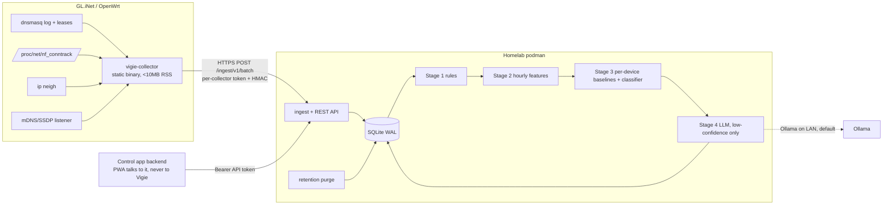

# PRP-001: Vigie — LAN device characterization service

Status: **DRAFT — awaiting owner review. No implementation until approved.**
License: AGPL-3.0-or-later. Branch: `docs/prp-initial`.

## 1. Goal and non-goals

**Goal.** Infer what each LAN device is (phone, tv, iot, camera, laptop, console) from observed behavior, flag anomalies, and expose a device inventory API for a separate access-control app.

**Non-goals.**
- Vigie never changes firewall rules, DNS, DHCP, or any router state. It emits *suggestions*; the control app enforces after human approval.
- No payload inspection, no TLS interception, no cloud processing by default.
- Not an IDS. Anomaly flags are hints for a human, not verdicts.

**Success is measured, not asserted** (see §10 exit criteria): per-phase accuracy against owner-labeled ground truth on the real LAN plus recorded fixtures.

## 2. Architecture



Key decisions (each is an open question to confirm in §12):

| Decision | Proposal | Why |
|---|---|---|
| Collector language | **Rust, musl, static** (Go as fallback) | mDNS/SSDP needs a multicast listener, which shell cannot do portably; Rust idles at ~1–2 MB RSS vs Go ~5–8 MB which risks the 10 MB budget. |
| Server language | **Python 3.12 + FastAPI + SQLite** | scikit-learn for stage 3; OpenAPI generated from models and committed. Python is banned only on the router. |
| Transport | **HTTPS POST only** in v1; MQTT deferred | One less dependency on the router and server. |
| DB | SQLite (WAL); repository interface so Postgres can follow | Single-writer is fine at ~30–100 devices. |

### Router vantage-point limits (be honest about what we cannot see)
- Only traffic **routed or bridged through the router** is visible. Wired devices behind a switch talking to each other, and Wi-Fi client-to-client traffic on the same AP, are invisible. Chromecast/AirPlay LAN-local streams appear only via mDNS.
- conntrack has **no per-flow timing**, only counters at sample time. At a 60 s sample, beacon periodicity from conntrack is limited to ≥60 s resolution; **DNS query timestamps (1 s resolution) are the primary periodicity signal.** Byte counters require `nf_conntrack_acct=1`.
- dnsmasq only logs queries with `log-queries=extra`. If the GL.iNet firmware uses **AdGuard Home** as resolver (common), dnsmasq will not see DNS and the collector must read AGH's query log instead. P1 begins with a spike to determine which applies on the owner's router and firmware version.
- DHCP option 55 is logged by dnsmasq with `log-dhcp` (believed; **verify in the P1 spike**, including option 60 vendor class).

## 3. Collector (router side)

- One static binary, procd-managed, runs as a **non-root user** where capabilities permit (CAP_NET_RAW not needed; reading `/proc/net/nf_conntrack` and the dnsmasq log file require group read access configured at install).
- Sources: lease file + `log-dhcp` lines; `ip neigh`; dnsmasq/AGH log **tailed from a tmpfs file** (`log-facility=/tmp/vigie/dnsmasq.log`, size-capped; never flash); conntrack summary; multicast join on 224.0.0.251:5353 and 239.255.255.250:1900 (parse names/service types/UA strings only, bounded length).
- Every 60 s: build a batch of **deltas** (DNS since cursor; conntrack aggregated per `(src_mac, dst_ip, dst_port, proto)` with bytes/pkts deltas and flow counts). Conntrack summarization happens on the router so raw flows never ship.
- **Budgets (hard, enforced in code and tested):** RSS < 10 MB; CPU < 2 % average on the target SoC; batch ≤ 256 KB; in-memory spool ≤ 1 MB, drop-oldest with a `dropped_batches` counter reported in the next successful batch.
- **Server down:** exponential backoff with jitter (cap 5 min); spool in RAM only; no disk writes. On recovery send spooled batches oldest-first; server dedupes by `batch_id`.
- **Auth:** per-collector 256-bit token provisioned at install; each batch carries `batch_id` (UUIDv7), `seq` (monotonic, persisted in tmpfs only → reset detected via `boot_id`), `ts`, and `HMAC-SHA256(token, canonical_body)`. TLS with the server cert **pinned by SPKI hash** in the collector config (self-signed OK). Server rejects: bad HMAC, `|ts-now| > 5 min`, duplicate `batch_id`, non-monotonic `seq` within a `boot_id`.
- **Attack surface:** the collector listens on multicast sockets (parsing untrusted LAN packets: fuzz targets, `#![forbid(unsafe_code)]` outside the socket shim) and opens no TCP listener. It has no inbound management port.

## 4. Data schema

Ownership is enforced **structurally, not by convention**: inferred data and human data live in different tables/columns, written by different code paths, and the API's effective view is computed on read. This extends the owner's draft schema (kept: `devices`, `device_identities`, `groups`, `events`, `suggestions`) with the changes marked ▲.

```sql
-- groups must be created before devices (FK order)
CREATE TABLE groups (
  id TEXT PRIMARY KEY,                -- trusted|kids|iot|guest|quarantine (seeded)
  name TEXT NOT NULL,
  enforcement_ref TEXT                -- opaque to Vigie; owned by control app
);

CREATE TABLE devices (
  id TEXT PRIMARY KEY,                -- stable UUIDv4, survives MAC changes
  first_seen TEXT NOT NULL,
  last_seen  TEXT NOT NULL,
  version INTEGER NOT NULL DEFAULT 1,  -- ▲ bumped on every human_*/group/identity change (ETag, accept guard)
  -- human-owned: written ONLY by PATCH /devices/{id} and accept-suggestion
  human_name  TEXT,
  human_owner TEXT,
  human_type  TEXT,
  group_id    TEXT REFERENCES groups(id),
  human_updated_at TEXT,              -- ▲ audit
  human_updated_by TEXT,              -- ▲ audit (control-app principal)
  -- vigie-owned: written ONLY by the inference pipeline
  inferred_type TEXT,                 -- phone|tv|iot|camera|laptop|console|unknown
  inferred_confidence REAL,
  inferred_source TEXT,               -- rules|ml|llm
  inferred_reason TEXT,
  inferred_model_version TEXT,        -- ▲ reproducibility
  status TEXT NOT NULL DEFAULT 'active'  -- active|retired   (▲ 'quarantined' removed, see below)
);

CREATE TABLE device_identities (
  device_id TEXT NOT NULL REFERENCES devices(id),
  mac TEXT NOT NULL,
  is_randomized INTEGER NOT NULL,
  dhcp_fingerprint TEXT,
  vendor_class TEXT,                  -- ▲ opt 60
  hostname TEXT,
  link_confidence REAL NOT NULL DEFAULT 1.0,   -- ▲ stitching confidence
  link_state TEXT NOT NULL DEFAULT 'confirmed',-- ▲ confirmed|tentative
  last_seen TEXT NOT NULL,
  PRIMARY KEY (device_id, mac)
);
CREATE UNIQUE INDEX uq_identity_mac ON device_identities(mac) WHERE link_state='confirmed'; -- ▲

CREATE TABLE collectors (             -- ▲
  id TEXT PRIMARY KEY, token_hash TEXT NOT NULL, spki_pin TEXT,
  last_seq INTEGER NOT NULL DEFAULT 0, boot_id TEXT, revoked INTEGER NOT NULL DEFAULT 0
);
CREATE TABLE batches (                -- ▲ replay protection; pruned at 7d
  batch_id TEXT PRIMARY KEY, collector_id TEXT NOT NULL, received_at TEXT NOT NULL
);

-- raw, retention-limited (default 7d), purged hourly
CREATE TABLE raw_dns  (ts TEXT, device_mac TEXT, qname TEXT, qtype TEXT, answer_ip TEXT);
CREATE TABLE raw_flow (ts TEXT, device_mac TEXT, dst_ip TEXT, dst_port INT, proto TEXT, bytes_up INT, bytes_down INT, flows INT);

-- long-term aggregates (no qnames, no IPs)
CREATE TABLE features_hourly (
  device_id TEXT, hour TEXT,
  distinct_domains INT, distinct_asns INT, up_down_ratio REAL,
  active_minutes INT, beacon_period_s REAL, beacon_regularity REAL,
  port_set TEXT, category_counts TEXT, doh_dot_flag INT,
  PRIMARY KEY (device_id, hour)
);
CREATE TABLE baselines (device_id TEXT PRIMARY KEY, model BLOB, trained_at TEXT, n_hours INT);  -- ▲

CREATE TABLE llm_summaries (           -- ▲ exact payload sent to the LLM; 7d retention
  id TEXT PRIMARY KEY, device_id TEXT, ts TEXT, provider TEXT, summary TEXT, response TEXT
);

CREATE TABLE events (
  id TEXT PRIMARY KEY, device_id TEXT REFERENCES devices(id), ts TEXT NOT NULL,
  kind TEXT NOT NULL,                  -- new_device|anomaly|drift|doh_detected|identity_merge_candidate
  severity TEXT NOT NULL, summary TEXT NOT NULL
);

CREATE TABLE suggestions (
  id TEXT PRIMARY KEY, device_id TEXT REFERENCES devices(id),
  action TEXT NOT NULL,                -- move_group|quarantine|label|merge_identity
  payload TEXT NOT NULL,               -- JSON, schema-validated per action
  reason TEXT NOT NULL,
  basis_version INTEGER NOT NULL,      -- ▲ device row version at creation (optimistic concurrency)
  state TEXT NOT NULL DEFAULT 'pending',   -- pending|accepted|rejected|expired
  expires_at TEXT NOT NULL,            -- ▲
  decided_by TEXT, decided_at TEXT
);
```

Notes on deviations from the draft:
- **`devices.status` loses `quarantined`.** Quarantine is a *group membership* (`group_id='quarantine'`) decided by a human. A Vigie-owned column that can say "quarantined" is a latent enforcement signal; keep status to `active|retired`.
- Human override of type is **per-field, nullable**: `effective_type = COALESCE(human_type, inferred_type, 'unknown')`. Pipeline code connects to the DB with a role/wrapper whose UPDATE statements are limited to `inferred_*`, `last_seen`, `status`; a test asserts that no pipeline statement mentions `human_*` or `group_id` (static check in CI) and a property test fuzzes pipeline outputs against a labeled device.
- Hostnames/qnames are never foreign keys into trust decisions.

## 5. API (OpenAPI 3.1 committed at `api/openapi.yaml`; CI fails if generated spec drifts)

| Method | Path | Notes |
|---|---|---|
| POST | `/ingest/v1/batch` | collector credentials only; HMAC + replay checks (§3) |
| GET | `/devices` | filter `type`, `group`, `status`, `updated_since`; cursor pagination; returns `effective_*` plus raw `human_*` / `inferred_*` |
| GET | `/devices/{id}` | adds identities, recent events, explanation |
| PATCH | `/devices/{id}` | `If-Match: <version>` required; sets `human_*`, `group_id`; `null` clears a field |
| GET | `/events` | `since` cursor, `kind`, `severity`; optional SSE `/events/stream` |
| GET | `/suggestions` | ▲ listing was missing from the brief |
| POST | `/suggestions/{id}/accept` | see §7 |
| POST | `/suggestions/{id}/reject` | ▲ |
| GET | `/healthz`, `/metrics` | unauthenticated `healthz` only returns `ok` |

Envelope: `{ "ok": bool, "data": ..., "error": {code,message}|null, "page": {next_cursor}|null }`.
Auth: two principal classes with disjoint scopes — `collector` (ingest only) and `app` (read + PATCH + suggestion decisions). Tokens stored hashed; bind to LAN interface only; no CORS (the PWA talks to the control-app backend, not directly to Vigie). All writes are audit-logged with principal.

## 6. Inference pipeline: rules vs ML vs LLM

| Stage | Handles | Output | Never does |
|---|---|---|---|
| 1 Rules | OUI (IEEE public registry), DHCP opt-55/60 fingerprints, mDNS service types, SSDP UA | label + confidence; high-confidence rules stop the pipeline | override `human_*` |
| 2 Features | hourly aggregates per device (§4) | `features_hourly` | retain qnames/IPs |
| 3 Local ML | (a) classifier for unlabeled/low-confidence devices; (b) **per-device baseline drift** (robust z-score/EWMA first, isolation forest per device once ≥ 14 days of hours) | label+confidence; `drift` / `anomaly` events | run with < min history (emit nothing, not noise) |
| 4 LLM | only devices still below a confidence threshold after stage 3 | label ∈ closed enum, confidence, reasoning text | take any action; see §6.1 |

Honest expectations: a home LAN has ~20–60 devices, so a cross-device ML classifier is data-starved. Cold-start labels come from stage-1 high-confidence results and owner labels (circularity risk: the model re-learns the rules; evaluate only on owner-labeled holdout). Per-device drift is the more valuable ML component. **Fingerbank's database is under its own license/terms** — Vigie ships its own rule set seeded from public sources (IEEE OUI, open DHCP-fingerprint lists) and offers an optional, off-by-default Fingerbank API adapter; license compatibility with AGPL to be confirmed before any data is vendored.

### 6.1 LLM stage constraints (prompt-injection posture)
- Input is a **generated aggregate summary**, never raw logs. Attacker-controlled strings (hostname, mDNS instance names, SSDP UA, qnames) are **excluded by default**; where included (top eTLD+1 only) they are length-capped, charset-normalized, and placed in a clearly delimited data block. System prompt states they are data.
- Output must parse to a JSON schema with `label` in the closed enum, `confidence` in [0,1], `reasoning` ≤ 500 chars. Anything else → discarded, device stays `unknown`.
- The LLM output writes **only** `inferred_*` and may create at most a `label` suggestion. It has no tool access and its output is never interpreted as instructions, SQL, or an action type. Suggestion `action`/`payload` are constructed by server code from the validated label.
- LLM-derived confidence is capped (e.g. ≤ 0.6) and can never trigger `move_group` or `quarantine` suggestions on its own; those require ≥ 1 non-LLM corroborating signal.
- Reasoning text is rendered as plain text by consumers (documented in the API contract).
- **Remote providers are opt-in**, require an explicit config flag, and receive a category-only summary (no domains). The README states plainly that enabling one ends the "all processing local" guarantee.

## 7. Suggestion and enforcement flow

1. Vigie creates a `pending` suggestion with `basis_version` and `expires_at` (default 7 d).
2. The control app displays it; a human approves in the app. The app calls `POST /suggestions/{id}/accept` with `If-Match` on the device version.
3. **What accept means in Vigie:** it records the decision and applies only *Vigie-side metadata* — `label` → sets `human_type`/`human_name`; `move_group` → sets `devices.group_id` (a record of intent). `quarantine` and `move_group` **cause no router change from Vigie**; the control app reads the group change and enforces on its own authority. This keeps §1's rule literal.
4. Accept is one SQLite transaction: `UPDATE suggestions SET state='accepted' WHERE id=? AND state='pending' AND expires_at>now AND (SELECT version FROM devices WHERE id=?)=basis_version`; rows-affected = 0 → `409`. This prevents double-accept, accept-after-expiry, and accept-after-the-device-changed (e.g. the device was re-labeled or merged meanwhile).
5. Expiry job, and invalidation of pending suggestions on any identity merge/split for that device.

## 8. Identity stitching

- Locally-administered MACs (bit 1 of first octet) are flagged `is_randomized`. Candidate matching for a new randomized MAC uses *(opt-55, opt-60, hostname, mDNS name, port/domain profile)*.
- **Never silently merge.** Below a high threshold a candidate becomes `link_state='tentative'` + an `identity_merge_candidate` event; tentative links carry **no** inherited `human_*` or `group_id`. A confirmed link requires (a) overlapping presence evidence is *absent* (two MACs concurrently active ⇒ different devices, hard veto) and (b) similarity above threshold, or human confirmation.
- A new/unmatched device gets **default-deny posture**: group `null` (control app treats null as most restrictive/"unassigned"), never inherits another device's group by heuristic.
- Known weak spots: identical fingerprints across same-model devices (family of identical iPhones with hostname "iPhone"); iOS/Android per-SSID MAC rotation. Merge errors are reversible via a split operation that restores prior identity rows (merge is logged, not destructive).
- Security stance on misclassification: camera labeled as phone is an **availability/visibility error, not a privilege grant**, because group assignment is human-owned and type is advisory. The control app should show `effective_type` provenance (human/inferred + confidence) and must never auto-assign group from `inferred_type`.

## 9. Privacy and security posture

- All processing local by default. What leaves the LAN: nothing, except (a) operator-enabled remote LLM provider (category summary only), (b) optional Fingerbank lookup (hash of fingerprint only; off by default), (c) no telemetry.
- Retention: `raw_dns`, `raw_flow`, `batches`, `llm_summaries` purged at 7 d (configurable, hard max 30 d); long-term tables hold aggregates and labels only. `reasoning` strings must not quote qnames (post-filter).
- **Backups:** SQLite file lives on an encrypted volume; the documented backup recipe excludes raw tables (`VACUUM INTO` of a copy with raw tables dropped). After purge, `PRAGMA secure_delete=ON` and periodic `VACUUM` so deleted raw rows do not persist in free pages/WAL.
- Secrets via env/podman secrets; startup fails if required secrets missing.
- Container: rootless podman, read-only rootfs, single writable volume, no extra capabilities, bound to the LAN interface.
- **DoH/DoT bypass:** detect (a) outbound 853, (b) 443 to a maintained list of known DoH resolver IPs, (c) a device with substantial outbound flows but zero DNS queries to the router. Emitted as `doh_detected` events and a feature flag that lowers classification confidence (DNS-derived features are blind). Docs include OpenWrt DNAT rules forcing port 53 to the router and blocking 853/known DoH IPs. Detection is heuristic; browsers on port 443 to a generic CDN are not catchable — documented as a limit.

## 10. Test strategy

- Fixtures: recorded (sanitized, MACs pseudonymized deterministically) captures per archetype in `tests/fixtures/`.
- `tools/trafficgen`: synthetic generator emitting collector-format batches for archetype profiles (phone, tv, camera, thermostat, laptop, console), MAC randomization, DoH users, and adversarial profiles (hostname spoofing, replayed batches).
- Collector: budget test (RSS/CPU measured under qemu or on the real router), fuzz targets for mDNS/SSDP/DHCP-log parsers.
- Security tests: replay, bad HMAC, clock skew, forged-hostname inheritance, LLM injection corpus, accept-race (concurrent accepts), pipeline-never-writes-`human_*` static + property tests.
- Coverage ≥ 80 %; accuracy reported per stage on owner-labeled holdout.

## 11. Phased plan

| Phase | Scope | Exit criteria |
|---|---|---|
| **P0** | Router spike: confirm dnsmasq vs AGH, `log-dhcp` fields, conntrack acct, SoC arch, RAM headroom | written findings in `docs/spikes/`; collector language confirmed |
| **P1** | Collector + ingest + inventory (devices, identities, events `new_device`), OpenAPI, compose file, trafficgen, README + install steps | collector < 10 MB RSS for 48 h on the real router; 100 % of LAN devices appear; replay/auth tests green |
| **P2** | Stage 1 rules + stage 2 features + DoH detection + retention purge | ≥ 85 % correct on owner-labeled devices (or documented reasons); purge verified |
| **P3** | Stage 3 ML (per-device drift first) + stage 4 LLM + stitching | drift false-alert rate ≤ agreed budget over 14 days; injection corpus yields zero label/action changes |
| **P4** | Control-app integration: suggestions, accept/reject, SSE, API hardening, contract tests | control app drives full label → move_group flow in staging; no router change originates from Vigie |

Each phase = one or more feature branches, PR each, reviewed by a separate reviewer pass.

## 12. Open questions for the owner

1. Router model, firmware version, SoC arch (mips/arm/aarch64)? Resolver: dnsmasq or AdGuard Home?
2. Collector in **Rust** (proposed) or Go?
3. Server in **Python** (proposed) given the ML stage?
4. `accept` for `move_group`/`quarantine` — confirm that it only records intent in Vigie and the control app reads it (§7.3).
5. Ollama host/model available on the homelab?
6. Remote LLM providers: allow at all?

## 13. Risks

| Risk | Impact | Mitigation |
|---|---|---|
| Router can't sustain collector budgets | P1 fails | P0 spike; reduce conntrack granularity |
| DNS data unavailable (AGH, DoH) | features blind | AGH adapter; DoH detection lowers confidence |
| Small-data ML overfits/circular | false confidence | per-device baselines; owner-labeled holdout only |
| Stitching false merge | wrong label/trust carry-over | tentative links, concurrency veto, no inheritance below threshold |
| Prompt injection via names | wrong label | exclusion, schema, caps, no action path (§6.1) |
| Fingerbank/OUI licensing | legal | own rule set; verify before vendoring |
| Log volume on flash | wear | tmpfs only |

## 14. Devil's advocate

1. **"Rules alone may be enough."** A good OUI + DHCP + mDNS ruleset plausibly classifies 85–90 % of a home LAN. Stages 3–4 may add complexity for the last 10 %. *Response:* P2 exit gate measures this; P3 is conditional on the residual `unknown` count being worth it. We should be willing to cancel P3.
2. **Classifier on ~30 devices is statistically weak** and trained on rule outputs it then "confirms". Only per-device drift has a sound basis, and it needs weeks of data before it says anything.
3. **Router vantage point is partial.** The device that matters most (a camera on a wired switch) may be invisible or only visible via mDNS. If so, characterization quality is capped regardless of ML.
4. **An LLM reading names chosen by devices (and thus by attackers) is an injection surface for a feature whose benefit is a marginal label.** Mitigated, but the safest design is no LLM at all; it ships last and off-by-default is acceptable.
5. **Identity stitching is a hard problem that vendors get wrong.** Our default of "tentative, no inheritance" may produce many duplicate devices and nag the owner; the cost is UX noise, chosen over false trust transfer.
6. **Is a separate service justified** versus extending an existing tool (Fingerbank + ntopng + a script)? The reason to build is the human-override inventory API and privacy posture; if the control app only needs a MAC→label table, this is over-engineered. Confirm that the three consumers (type, owner, group) justify it.
7. **Suggestion fatigue.** Two household users approving frequent suggestions will start rubber-stamping — a human-in-the-loop that degrades to no loop. Rate-limit suggestions, batch, and expire.
8. **Single point of failure for trust metadata:** if Vigie's DB is lost, group assignments vanish. Control app should hold the authoritative copy of group enforcement; Vigie's `group_id` is a mirror/intent record. Backup recipe must include human tables.
